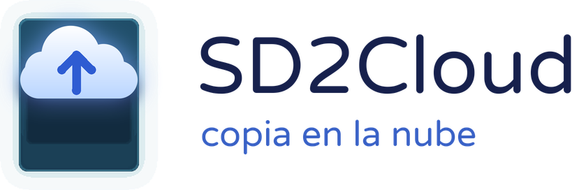
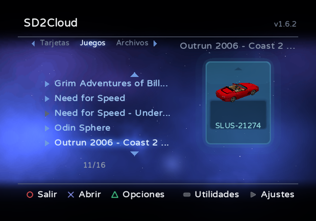
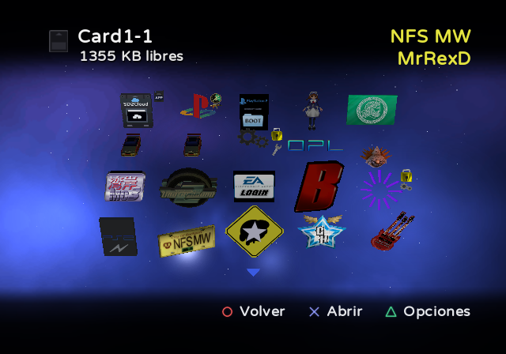
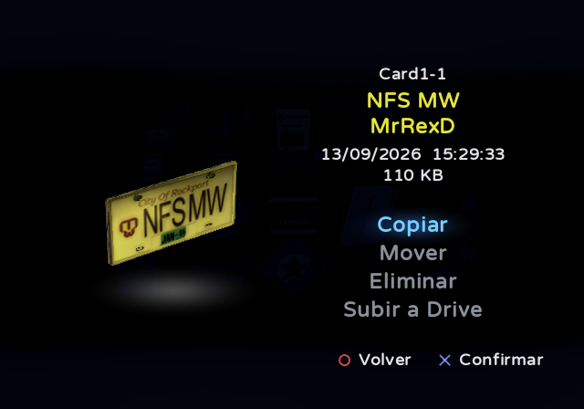
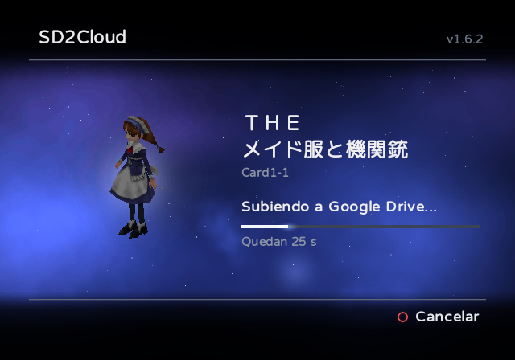
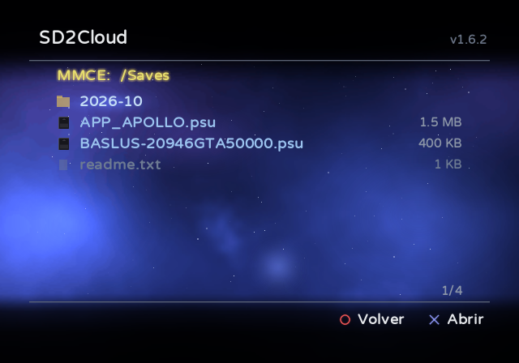
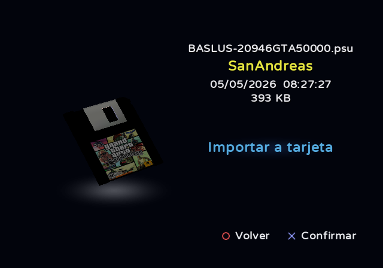

<h1>
  <picture>
    <source media="(prefers-color-scheme: dark)" srcset="docs/logo/es/dark.png">
    <source media="(prefers-color-scheme: light)" srcset="docs/logo/es/light.png">
    
  </picture>
</h1>

**Administra y respalda las tarjetas de memoria de tu PS2, directamente en la consola.**

> [!WARNING]
> SD2Cloud escribe en tus tarjetas de memoria cada vez que copia, mueve, elimina, importa o restaura partidas, y cada
> vez que crea, cambia de tamaño o elimina tarjetas. Haz una copia antes: sincroniza tus tarjetas con Google Drive o
> copia la carpeta `MemoryCards` de la microSD a un PC.

SD2Cloud es una aplicación que funciona en la propia PS2, sin necesidad de PC. Hace copias de tus tarjetas de memoria
en Google Drive y te permite organizar tus partidas guardadas directamente en la consola.

Funciona con:
- **Dispositivos de la familia sd2psx** (sd2psx, PSXMemCard, PSXMemCard Gen2, PicoMemcard+/Zero) con el firmware
  [sd2psXtd](https://github.com/sd2psXtd/firmware). En la PS2, estos dispositivos (y su microSD) se conocen como
  **MMCE**, y ese es el nombre que usa esta página.
- **MemCard PRO2**.
- **Memory Cards comunes**: las tarjetas físicas, en las ranuras de la consola.
- **VMC del OPL** (las tarjetas de memoria virtuales) y otros archivos de tarjeta de memoria guardados en una memoria
  USB, un MX4SIO o el disco duro interno.

[English](README.md) · [Português](README.pt-BR.md) · **Español** · [Русский](README.ru.md) · [Українська](README.uk.md) · [日本語](README.ja.md)

  
  

  
  

  
  

## Funciones

**Copias en Google Drive**
- Sincroniza tus tarjetas de memoria con tu Google Drive cuando quieras, o automáticamente cada vez que sales de un
  juego con IGR (In-Game Reset, la combinación de botones de OPL para salir de un juego). Solo se suben las tarjetas
  que cambiaron.
- Guarda un historial de copias de cada tarjeta (10 por defecto), y puedes restaurar cualquiera de ellas. La tarjeta
  se verifica antes y después de escribirla. Si una tarjeta cambió desde su última copia, SD2Cloud la copia antes de
  restaurar otra encima, para que no se pierda nada.
- Sube cada tarjeta como archivo `.mcd`, el formato del propio sd2psx. Si lo prefieres, elige `.ps2` en los ajustes:
  es el formato de PCSX2, así que una tarjeta sacada del zip de su copia ya está lista para el emulador. Los dos se
  pueden restaurar.
- **Copia por partida** (opcional): también sube cada partida que cambió como un archivo aparte, y guarda sus
  versiones anteriores. La página de una partida muestra sus **Versiones en Drive**, y puedes restaurar cualquiera.
- En Drive, las copias se ordenan en carpetas por dispositivo, juego y tarjeta, y cada tarjeta tiene una carpeta
  Saves. Puedes recorrerlas desde la pestaña **Archivos**: abrir la página de una partida, abrir la copia de una
  tarjeta como si fuera una tarjeta, instalarla, o descargar y eliminar cualquier archivo.
- Conectas tu cuenta de Google una sola vez, con un código o un código QR. SD2Cloud solo puede ver los archivos que
  él mismo crea en tu Drive.

**Administrador de tarjetas de memoria**
- Muestra las partidas de cada tarjeta como el navegador de la PS2, con los iconos 3D animados.
- Copia, mueve y elimina partidas entre tarjetas, varias a la vez, incluso de tarjetas distintas. También puede subir
  una sola partida a Google Drive como archivo `.psu` (el formato habitual de una partida suelta de PS2).
- La **Biblioteca** guarda partidas fuera de las tarjetas, cada una en un archivo propio, ordenadas por juego y sin
  límite de espacio. Sirve cuando una Memory Card está llena, o para sacar una partida de una tarjeta sin eliminarla.
  También puede estar en Drive.
- Las **herramientas de tarjeta** crean, cambian de tamaño, cambian de nombre, comprueban y eliminan tarjetas:
  - una tarjeta nueva puede ser numerada, estar en una carpeta con el nombre que quieras o ser un archivo de tarjeta
    en cualquier dispositivo. El tamaño va de 1 a 64 MB en un sd2psx y de 8 a 128 MB en una MemCard PRO2, con el
    tamaño recomendado marcado;
  - **Convertir a Game ID** divide una tarjeta en una tarjeta por juego. Las tarjetas Game ID son las que el sd2psx
    elige solo cuando empieza un juego. Todo ocurre en una sola pantalla, que muestra el tiempo restante;
  - antes de cualquier cambio que pueda perder datos, SD2Cloud guarda una **copia de seguridad** de la tarjeta, que
    puedes restaurar desde Utilidades.
- Las tarjetas se ordenan en pestañas: tarjetas numeradas y tus carpetas, tarjetas de juego (Game ID) en carpetas con
  el nombre de cada juego, tarjetas de arranque, los **VMC del OPL** y la Biblioteca. La pestaña de VMC muestra qué
  juegos usan cada VMC, y también incluye las carpetas de VMC del disco duro, de un MX4SIO o de una memoria USB.
- **Todas las partidas**, en la pestaña Juegos, muestra las partidas de todas las tarjetas de juego en una sola
  pantalla, como si fueran una sola tarjeta.
- Muestra qué tarjeta está usando el sd2psx y puede cambiarla por otra. Para modificar la tarjeta en uso, SD2Cloud
  pregunta primero, pasa el sd2psx a otra tarjeta mientras trabaja y después vuelve a ella.
- La pestaña **Archivos** recorre el MMCE, una memoria USB, el disco duro interno y un MX4SIO. El disco duro puede ser
  exFAT, FAT32 o APA, incluidos los discos preparados por el instalador de PSBBN, que tienen los dos. Desde ahí
  puedes:
  - importar y exportar archivos `.psu` y partidas en formato de carpeta;
  - abrir archivos de tarjeta de memoria (`.mcd`, `.mc2`, `.ps2`, el `.bin` de OPL o un `.zip`) e instalarlos como
    tarjetas, o como archivo de tarjeta en cualquier dispositivo, en el formato que elijas;
  - copiar una tarjeta entera a una carpeta, como `.zip`.
- Administra las **Memory Cards** comunes de las ranuras de la consola: sus partidas, y la tarjeta entera subida a
  Drive y restaurada desde allí.
- Si la microSD tiene tarjetas de un sd2psx y de una MemCard PRO2, **L2 y R2** cambian entre las tarjetas de uno y de
  otro, para que copies partidas entre los dos.
- **Plantillas**: una plantilla es un conjunto de partidas que eliges de tus tarjetas, para ponerlas en cualquier
  tarjeta de una vez. Una de ellas puede ser la plantilla **principal**, la que toda tarjeta de juego debería tener:
  se puede poner en todas de una vez y, cuando la tarjeta de un juego nuevo no la tiene, SD2Cloud ofrece ponerla al
  abrirse. Con la sincronización automática, la tarjeta que usó un juego recibe sus plantillas sola cuando sales del
  juego. Las plantillas están en **Utilidades** (SELECT).

**Además**
- Funciona **sin sd2psx**: ábrelo desde una memoria USB, un MX4SIO o el disco duro interno, y guarda sus datos allí.
  Administra las Memory Cards de las dos ranuras (con copia partida por partida), los VMC del OPL y los archivos de
  tarjeta.
- Puedes quitar el sd2psx y volver a ponerlo con SD2Cloud abierto: las pantallas se actualizan solas.
- Pide confirmación antes de cualquier cosa que suba, escriba o elimine datos.
- Los ajustes están en la propia consola (START), divididos en páginas, y se guardan en `sd2cloud.ini`, que también se
  puede editar en un PC.
- Al salir, puede volver a OPL en el MMCE, una tarjeta de memoria, USB, MX4SIO o el disco duro interno (exFAT o APA),
  cargando solo los controladores de ese dispositivo.
- Inicia otros programas: cualquier ELF de las carpetas de un dispositivo (X sobre él en **Archivos**, o "Ejecutar un
  ELF..." al salir) y aplicaciones guardadas en una tarjeta de memoria en el formato del Save Application System
  ("Iniciar aplicación" en su página).
- Se actualiza desde las releases de este repositorio y verifica cada descarga con el SHA-256 que publica GitHub. Hay
  dos canales, que se eligen en los ajustes:
  - **Estable**: las versiones publicadas;
  - **Beta**: una compilación hecha automáticamente con cada cambio, antes de las pruebas por las que pasa una versión
    (la [pre-release beta](../../releases/tag/beta)).
- Interfaz inspirada en el PlayStation BB Navigator.
- En inglés, portugués, español, ruso, ucraniano y japonés. Las traducciones son bienvenidas: consulta
  [Translating](CONTRIBUTING.md#translating). Las partidas de juegos japoneses muestran su título en japonés.

## Requisitos

- Uno de estos:
  - un dispositivo de la familia sd2psx con el firmware sd2psXtd (compatible con MMCE);
  - una MemCard PRO2. SD2Cloud lee y escribe sus tarjetas `.mc2`, en la carpeta `/PS2`. En la PRO2, cambiar de tarjeta
    desde la aplicación ("Insertar esta tarjeta") todavía es una función en vista previa, y SD2Cloud nunca cambia de
    tarjeta por su cuenta: para modificar la tarjeta en uso, cambia primero a otra;
  - ninguno de los dos: SD2Cloud en una memoria USB, un MX4SIO o el disco duro interno, con Memory Cards comunes en
    las ranuras.
- Una forma de abrir SD2Cloud: la pestaña Apps de OPL, wLaunchELF o cualquier otro programa que abra archivos ELF. Si
  puedes, usa un OPL compatible con MMCE, como [RiptOPL](https://github.com/NathanNeurotic/Open-PS2-Loader). Un OPL
  sin esa compatibilidad no muestra las aplicaciones del MMCE y no tiene la opción **IGR Bootcard Slot(s)**. Por eso,
  con tarjetas Game ID, al salir de un juego con IGR el sd2psx se queda en la tarjeta del juego, la PS2 vuelve a su
  navegador en lugar de abrir SD2Cloud, y la sincronización automática no ocurre.
- Para la sincronización automática después de un juego: OPL, que abre SD2Cloud con el IGR.
- Para las funciones en la nube: una cuenta de Google y una PS2 con adaptador de red (incorporado en los modelos Slim)
  conectada al router por cable.

## Instalación

1. Descarga `SD2Cloud-vX.Y.zip` desde la [última release](../../releases/latest).
2. Extráelo en la raíz del MMCE. Esto añade:
   - `APPS/SD2Cloud`: la aplicación;
   - `ART`: la carátula y el logo que OPL muestra para SD2Cloud en su pestaña Apps;
   - `Extras`: el mismo arte con su línea en portugués (para copiarlo sobre los dos archivos de `ART`), el paquete SAS
     (ver más abajo) y `sd2cloud.example.ini`, que explica cada ajuste.

   La primera vez que se abre, SD2Cloud crea su archivo de ajustes, `SD2Cloud/sd2cloud.ini`. El zip no trae ese
   archivo, así que extraer una versión nueva sobre la anterior conserva tus ajustes.
3. Abre SD2Cloud desde la pestaña Apps de OPL, o ejecuta `APPS/SD2Cloud/SD2CLOUD.ELF` desde cualquier programa que
   abra archivos ELF (wLaunchELF, por ejemplo). La carpeta no tiene que quedarse en `APPS`.
4. Cuando te lo pida, conecta tu cuenta de Google (o más tarde, en Ajustes > Google Drive): entra en
   google.com/device en tu teléfono o computadora, o escanea el código QR, y escribe el código que aparece en la TV.
5. Después, SD2Cloud ofrece activar la sincronización automática y sincronizar todas tus tarjetas.

**Sin sd2psx**, extrae el zip en una memoria USB (FAT32 o exFAT), un MX4SIO o el disco duro interno, y abre
`APPS/SD2Cloud/SD2CLOUD.ELF` desde allí. SD2Cloud guarda sus ajustes y sus datos en ese dispositivo. En ese caso, lo
que respalda son las Memory Cards de las ranuras, partida por partida (la copia por partida viene activada), y la
primera sincronización ya las ofrece. Si ese dispositivo tiene carpetas de un sd2psx, para SD2Cloud son solo
archivos: ábrelas desde la pestaña **Archivos**.

**Con sd2psx, pero la aplicación en otro dispositivo.** SD2Cloud también puede estar en una memoria USB, un MX4SIO o
el disco duro interno (exFAT o APA). Pon allí la carpeta `APPS/SD2Cloud` y abre SD2Cloud desde allí una vez. Entonces
registra dónde está, guarda en el MMCE (en `SD2Cloud/drivers`) los controladores que el paquete SAS necesita para
iniciarlo desde ese dispositivo, y se actualiza en ese lugar. Sus ajustes y sus datos se quedan en el MMCE.

**El paquete SAS, en la tarjeta de memoria.** Cuando activas la sincronización automática, SD2Cloud pone su paquete
SAS (Save Application System) en la tarjeta de memoria en uso. Es la carpeta `APP_SD2CLOUD`, de unos 240 KB, con:
- el programa que OPL ejecuta en el IGR;
- un acceso directo que abre SD2Cloud esté donde esté, con su propio icono 3D en el navegador de la PS2;
- sin sd2psx, también los controladores del dispositivo donde está SD2Cloud (unos 90 KB más).

SD2Cloud en sí se queda donde está. El zip también trae el paquete como `Extras/APP_SD2CLOUD.psu`, para importarlo a
mano a otra tarjeta (la propia pestaña **Archivos** de SD2Cloud lo hace). Después, abre SD2Cloud una vez desde donde
esté, y el acceso directo lo encuentra.

**¿Vienes de una versión anterior a la 2.0?** La versión 2.0 ordena las copias en Drive de otra manera: por
dispositivo, juego y tarjeta. La primera vez que se abre, SD2Cloud ofrece mover tus archivos a las carpetas nuevas,
sin volver a subir nada. "Ahora no" mantiene la organización antigua, y Ajustes > Google Drive vuelve a ofrecer el
cambio.

El [README.txt](package/README.txt) que viene en el zip explica cada pantalla en detalle (en inglés).

## Controles

| Pantalla | Botones |
|---|---|
| Pantalla principal | Arriba/Abajo: elegir la tarjeta · Izquierda/Derecha o L1/R1: cambiar de pestaña · L2/R2: las tarjetas del otro dispositivo (en una microSD con los dos) · X: abrir la tarjeta · TRIÁNGULO: opciones de la tarjeta (sincronizar ahora, restaurar una copia, copiar a un dispositivo, insertar en el sd2psx, cambiar nombre, cambiar tamaño, convertir a Game ID, comprobar tarjeta, eliminar tarjeta) · SELECT: Utilidades · START: Ajustes · O: salir |
| Dentro de una tarjeta | X: abrir una partida · TRIÁNGULO: opciones (sincronizar esta tarjeta; ordenar las partidas por nombre o por fecha; convertir a Game ID; en Todas las partidas, mostrar u ocultar las repetidas y exportarlas todas a una tarjeta; en la Memory Card, subirla a Drive o restaurar una copia) · O: volver |
| La página de una partida | Copiar · Mover · Eliminar · Subir a Drive · Versiones en Drive |
| Después de Copiar | La partida queda seleccionada, y puedes seleccionar otras: X selecciona o deselecciona una partida (mantén X y mueve el cursor para hacer varias seguidas) · O: volver a la lista de tarjetas, para seleccionar partidas de otras tarjetas también · TRIÁNGULO: cancelar · START: pegarlas todas en la tarjeta abierta, o en la tarjeta bajo el cursor en la lista. En la pestaña Juegos de la lista, la carpeta de su juego aparece primero, resaltada, con "Nueva tarjeta" dentro. La pestaña Biblioteca las guarda fuera de las tarjetas. En la pestaña Archivos, X abre las carpetas de un dispositivo, y START pega las partidas ahí como archivos `.psu`, o dentro del archivo de tarjeta de memoria bajo el cursor. START en la Memory Card las pega en ella |
| Pestaña Archivos | X: abrir un dispositivo, una carpeta, un archivo `.psu` o un archivo de tarjeta de memoria · CUADRADO: instalar el `.psu` o la carpeta de partida seleccionados en una tarjeta, o instalar el archivo de tarjeta seleccionado como tarjeta del MMCE o como archivo en un dispositivo (en la pestaña Archivos de ese dispositivo) · Izquierda/Derecha: una página arriba o abajo · O: volver |
| Pestaña Archivos > Google Drive | X: abrir una carpeta, el `.psu` de una partida (su página: importar a una tarjeta, descargar, eliminar de Drive) o la copia de una tarjeta (se abre como tarjeta) · CUADRADO: instalar la copia de una tarjeta (como desde la propia tarjeta), o descargar cualquier otro archivo · TRIÁNGULO: eliminarlo (va a la papelera de Drive) · O: volver |
| Utilidades (SELECT) | Plantillas (X: crear una plantilla o abrir una; TRIÁNGULO: fijar como principal, agregar partidas, aplicar plantilla, juegos de la plantilla, cambiar nombre, eliminar) · Copias de seguridad (X: restaurar una, o eliminarla) |
| Ajustes (START) | Sincronizar todas las tarjetas · Google Drive (cuenta, copias conservadas, formato, copia por partida, Biblioteca en Drive) · Sincronización automática (activada o desactivada, paquete SAS, salida del IGR) · Tarjetas (dispositivo, tamaño de tarjetas nuevas, carpetas de VMC del OPL) · Actualizaciones · Idioma · Acerca de |
| Durante una sincronización | O: cancelar · CUADRADO: omitir la tarjeta que se está subiendo · SELECT: la lista de las tarjetas de esta sincronización y cómo fue cada una (SELECT otra vez vuelve). En esa lista, CUADRADO omite una tarjeta (otra vez: deshace), y X ofrece omitirla, marcarla como resuelta (la sincronización automática la deja de lado hasta que vuelva a cambiar) o desactivar su sincronización |

## Sincronización automática después de un juego (IGR)

1. En SD2Cloud, abre Ajustes (START) > Sincronización automática y elige **Paquete SAS** (también se ofrece justo
   después de conectar tu cuenta). SD2Cloud muestra cuánto espacio necesita (unos 240 KB) y pregunta antes de escribir
   la carpeta `APP_SD2CLOUD` en la tarjeta de memoria en uso. Si usas Autoboot, instálalo con la BootCard en uso.
2. En los ajustes de OPL, pon en **IGR Path** `mc0:/APP_SD2CLOUD/IGR.ELF` (`mc1:` si el sd2psx está en la ranura 2;
   SD2Cloud muestra la ruta correcta al instalar el paquete). Si la versión 1.5 o una anterior dejó su asistente en
   la tarjeta, en `mc0:/BOOT/SD2CLOUD-IGR.ELF`, esa ruta sigue funcionando: instalar el paquete también actualiza ese
   archivo.
3. En OPL, activa también **IGR Bootcard Slot(s)** (página MMCE), con la ranura del sd2psx o BOTH. Así, al salir de
   un juego, OPL vuelve a la BootCard, donde está el paquete.

A partir de entonces, salir de un juego con IGR abre SD2Cloud, que sube las tarjetas que cambiaron y vuelve a OPL. La
misma opción de los Ajustes reinstala o quita el paquete.

SD2Cloud puede estar en cualquier carpeta, en el MMCE o en otro dispositivo. Cada vez que se abre, registra dónde
está (en `sd2cloud.ini` del MMCE; sin sd2psx, en el propio paquete, junto con los controladores de ese dispositivo),
y el paquete lo inicia desde allí. Encuentra incluso una carpeta de `APPS` a la que se le cambió el nombre.

Para pausar la sincronización sin desinstalar nada, pon **Sincronización automática** en Desactivada en los Ajustes.
El IGR entonces se salta SD2Cloud y va directo al programa que se abriría después. Lo mismo ocurre mientras no haya
una cuenta de Google conectada.

**Sin instalar nada (memoria USB).** El IGR de OPL también puede iniciar un programa desde una memoria USB. Si la
carpeta `APPS/SD2Cloud` está en una memoria USB formateada en FAT32, omite el paso 1 y pon en **IGR Path**
`mass:/APPS/SD2Cloud/SD2CLOUD-IGR.ELF`. No se escribe nada en la tarjeta de memoria. Para que funcione, OPL carga los
controladores USB `USBD.IRX` y `USBHDFSD.IRX` desde `mc?:/SYS-CONF`, donde los instala FMCB. Con el paquete SAS en la
tarjeta de memoria nada de esto hace falta, esté donde esté SD2Cloud: el paquete lo inicia desde el MMCE, una memoria
USB, un MX4SIO o el disco duro.

Si tu OPL no está en el MMCE, pon su ruta en la sección `[igr]` de `sd2cloud.ini`, empezando por el dispositivo:
`mc?:/` (tarjeta de memoria), `mass:/` (USB), `mx4sio:/`, `ata:/` (disco duro interno, exFAT) o
`hdd0:PARTICIÓN:pfs:/` (disco duro interno, APA). Por ejemplo: `hdd0:__common:pfs:/APPS/OPL/OPNPS2LD.ELF`.

## Privacidad

Tus tarjetas de memoria van de la PS2 directo a tu propio Google Drive. No interviene ningún otro servidor y no se
recopila nada. SD2Cloud usa el permiso `drive.file`, así que solo puede ver los archivos que él mismo crea. Puedes
revocar el acceso en cualquier momento en [myaccount.google.com/permissions](https://myaccount.google.com/permissions).
Además de Google, SD2Cloud solo se conecta a GitHub, y solo cuando eliges Buscar actualizaciones en los ajustes.

## Compilación

SD2Cloud está escrito en C con la toolchain de [ps2dev](https://github.com/ps2dev) (ps2sdk, ps2sdk-ports, gsKit).

1. `tools/build_ports.sh` compila wolfSSL y curl con soporte de RSA de 4096 bits en `ports4096/` (el HTTPS de Google
   lo necesita).
2. `tools/build_mmceman.sh` compila mmceman, el controlador del sd2psx, en `third_party/mmceman/` (el que viene con el
   SDK puede colgar el sd2psx en transferencias largas).
3. Crea un cliente OAuth del tipo "TVs and Limited Input devices" en Google Cloud Console, con la API de Drive
   activada, y genera `src/credentials.h`: `python tools/make_credentials.py client_secret.json src/credentials.h`.
4. `make` compila `dist/SD2CLOUD.ELF` y, en `igr/`, los dos programas pequeños del paquete SAS (el asistente del IGR y
   el acceso directo); `make DEBUG=1` compila una versión de depuración para PCSX2.
5. `python tools/make_release.py` empaqueta la release en `dist/`, con los textos de `package/`.

`make -C tests` ejecuta las pruebas de regresión, con el compilador del propio PC y sin la toolchain de la PS2: consulta
[tests/README.md](tests/README.md). [docs/ARCHITECTURE.md](docs/ARCHITECTURE.md) es el mapa del código (en inglés).

## Reportar errores y contribuir

¿Encontraste un problema? Abre un [issue](../../issues/new/choose) y completa el formulario: la versión de SD2Cloud, la
consola, el dispositivo sd2psx y su firmware, cómo se abrió SD2Cloud y los pasos que llevan al problema. Las ideas y
sugerencias también son bienvenidas allí. Los issues se pueden escribir en inglés o en portugués.

Los pull requests son bienvenidos. [CONTRIBUTING.md](CONTRIBUTING.md) explica cómo compilar, las convenciones del código
y qué revisar antes de enviar uno.

## Créditos y licencia

SD2Cloud es desarrollado por MrRexD y se distribuye bajo la [GNU General Public License v3](LICENSE).

El diseño está inspirado en el PlayStation BB Navigator. SD2Cloud usa la fuente
[Varela Round](https://github.com/alefalefalef/Varela-Round-Hebrew), con las letras cirílicas de
[Nunito](https://github.com/googlefonts/nunito) y los caracteres japoneses de
[M PLUS Rounded 1c](https://github.com/coz-m/MPLUS_FONTS) (las tres bajo la SIL Open Font License), y las bibliotecas
listadas en [THIRD-PARTY-NOTICES.txt](package/THIRD-PARTY-NOTICES.txt).

PlayStation es una marca registrada de Sony Interactive Entertainment. SD2Cloud no está afiliado a Sony ni a Google, ni
cuenta con su respaldo.
