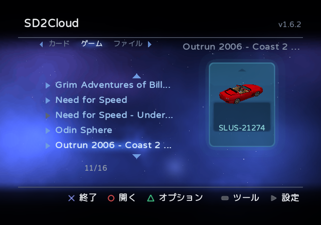
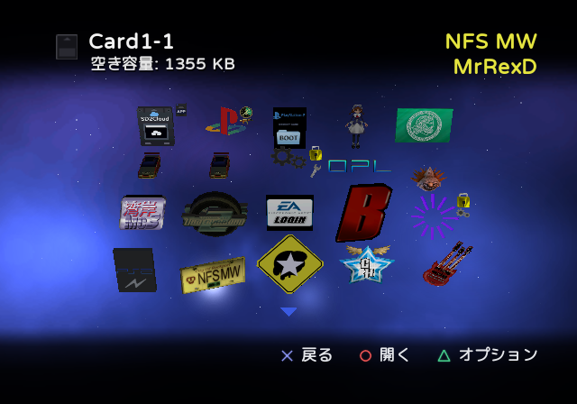
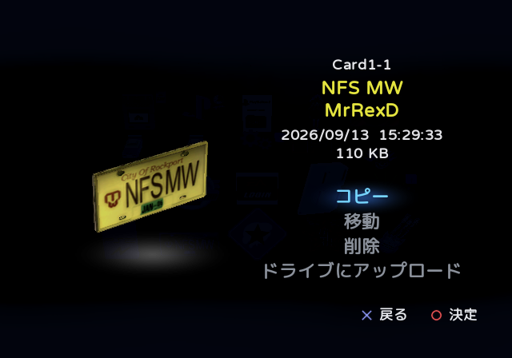
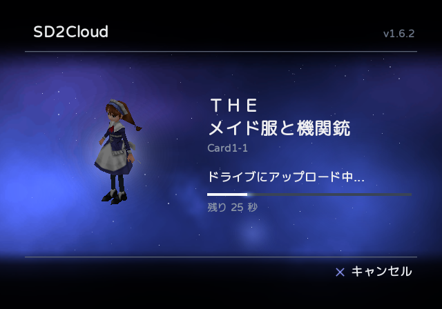
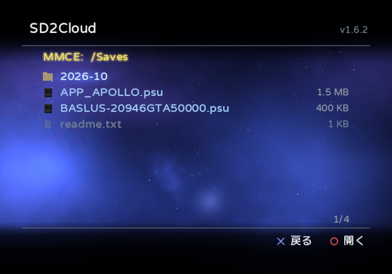
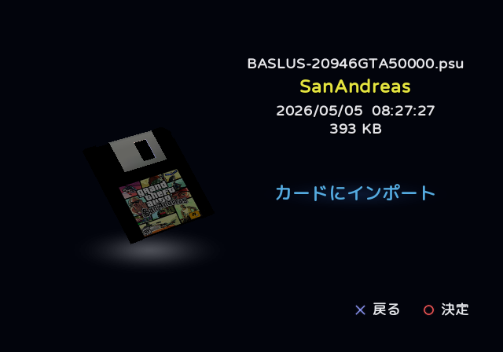

<h1>
  <picture>
    <source media="(prefers-color-scheme: dark)" srcset="docs/logo/ja/dark.png">
    <source media="(prefers-color-scheme: light)" srcset="docs/logo/ja/light.png">
    
  </picture>
</h1>

**sd2psx のメモリーカードを PS2 本体で管理・バックアップ。**

> [!WARNING]
> SD2Cloud は開発の初期段階にあり、まだ十分にテストされていません。セーブデータのコピー、移動、削除、インポート、
> 復元を行う前に、メモリーカードをバックアップしてください（microSD の `MemoryCards` フォルダーを PC にコピー）。

SD2Cloud は PS2 本体で動作し、[sd2psXtd](https://github.com/sd2psXtd/firmware) ファームウェアを搭載した sd2psx 系デバイス
（sd2psx、PSXMemCard、PSXMemCard Gen2、PicoMemcard+/Zero）の MMCE（PS2 から見た sd2psx の microSD）に保存された
メモリーカードを扱います。PC は必要ありません。MemCard PRO2 も試験的に認識しますが、SD2Cloud はまだ実機で試されていません。

[English](README.md) · [Português](README.pt-BR.md) · [Español](README.es.md) · [Русский](README.ru.md) · [Українська](README.uk.md) · **日本語**

  
  

  
  

  
  

## 機能

**クラウド同期**
- メモリーカードを Google ドライブと同期します。手動でも、IGR でゲームを終了するたびに自動でも同期できます。
  変更されたカードだけがアップロードされます。
- カードごとにバックアップの履歴を残し（既定では 10 個）、どれでも復元できます。書き込みの前後に検証します。
  変更されたカードは復元の前に同期されるので、何も失われません。
- 各カードは sd2psx 自身の `.mcd` 形式で送られます。設定で選べば、PCSX2 が使う `.ps2` 形式でも送れます。バックアップの
  zip から取り出せば、そのままエミュレーターで使えます。どちらの形式も復元できます。
- サインインはコードまたは QR コードで一度だけ。SD2Cloud がアクセスできるのは、ドライブ上で自分が作成したファイルだけです。

**メモリーカードマネージャー**
- 各カードのセーブデータを、PS2 ブラウザーと同じように動く 3D アイコン付きで表示します。
- MMCE 上のカード間でセーブデータをコピー、移動、削除し（コピー先の空き容量を表示）、1 つのセーブデータを
  `.psu` ファイルとして Google ドライブにアップロードします。1 枚または複数のカードで選んだセーブデータを、まとめて
  コピーできます。セーブデータは、その場で作るそのゲームの新しいカード（「ゲーム」タブの「新しいカード」）にも
  送れます。デバイス自身が作るのと同じ空の 8 MB のカードで、ゲームのテンプレートも入ります。
- すべてのゲームカードのセーブデータを、1 枚のカードのように 1 つの画面に表示します（「ゲーム」タブの
  **すべてのセーブデータ**）。
- カードをタブに分けて整理します。番号付きのカード、ゲーム名のフォルダーに入ったゲーム（Game ID）のカード、
  ブートカードです。
- sd2psx が使用中のカードを示し、別のカードに切り替えられます（カードのオプション）。使用中のカードを変更する
  ときは、確認してから sd2psx を別のカードに切り替え、元に戻します。
- カード全体を、`.mcd` または `.ps2` を入れた `.zip` として、MMCE や USB ドライブのフォルダーにコピーします
  （カードのオプション）。
- **ファイル** タブでメモリーカードのファイル（`.mcd`、MemCard PRO2 の `.mc2`、PCSX2 の `.ps2`、OPL の仮想メモリー
  カード（`.bin`）、または上記の `.zip`）を開き、セーブデータを取り出してコピーしたり、MMCE にインストールしたり
  できます。新しいカード（番号付き、ゲームのカード、または BootCard の新しいチャンネル）としても、既存のカードの
  置き換えとしてもインストールできます。
- `.psu` ファイルのインポートとエクスポート。**ファイル** タブで MMCE と USB ドライブ（FAT32 または exFAT）の
  フォルダーを開き、`.psu` を任意のカードにインストールし、カードのセーブデータを `.psu` として保存します。
  wLaunchELF などのファイラーでカードからフォルダーのままコピーしたセーブデータも、同じようにインストールできます。
  書き込んだ内容は読み返して照合します。
- 本体のもう一方のスロットにある通常の **メモリーカード** を **ファイル** タブから管理します。セーブデータは
  カードと同じように表示、コピー、移動、削除でき、デバイスのカードや `.psu` ファイルからセーブデータを書き込めます。
  セーブデータ、またはカード全体を Google ドライブにアップロードすることもできます。
- **テンプレート** を保存します。カードで選んだセーブデータのセットで、MMCE に保存され、一度に任意のカードへ
  書き込めます。デバイスは新しいゲームのカードを空の状態で作ります。テンプレートは、オンラインゲームが求める
  ネットワーク設定のように、すべてのカードに入れておきたいものをそのカードに加えます。カードにすでにあるセーブ
  データには一切触れません。1 つのテンプレートを、すべてのゲームカードに入れるべき **デフォルト** にできます。
  デフォルトのテンプレートはすべてのゲームカードに一度に書き込まれ、SD2Cloud を開いたときにそれがないゲーム
  カード（新しいゲームのカード）が見つかると、そのことを知らせて書き込みを提案します。テンプレートを一部の
  ゲーム専用にもできます。自動同期では、ゲームが使ったカードがゲームを終了するときに自動でテンプレートを
  受け取ります。**ツール**（SELECT）にあります。テンプレートのセーブデータは変更として扱われません。同期済みの
  カードは同期済みのままです。

**その他**
- データをアップロード、書き込み、削除する操作の前には、必ず確認します。
- 本体上の設定（START）は `sd2cloud.ini` に保存され、PC でも編集できます。
- MMCE、メモリーカード、USB、MX4SIO、内蔵 HDD（exFAT または APA）上の OPL に戻ります。そのデバイスの
  ドライバーだけを読み込みます。
- 他のプログラムを起動します。MMCE や USB ドライブのフォルダーで選んだ ELF（**ファイル** で選んで ○、または
  終了時の「ELF を実行...」）や、Save Application System の方式でメモリーカードに保存されたアプリケーション
  （そのページの「アプリケーションを起動」。起動のために sd2psx をそのカードに切り替えます）。
- このリポジトリのリリースから自動で更新し、GitHub の SHA-256 で検証します。チャンネルは設定で選べます。
  リリースされたバージョンの **安定版** と、変更のたびに自動で作られ、リリース前のテストを経ていない **ベータ**
  （[ベータのプレリリース](../../releases/tag/beta)）です。
- PlayStation BB Navigator にインスパイアされたインターフェース。
- 英語、ポルトガル語、スペイン語、ロシア語、ウクライナ語、日本語に対応。翻訳を歓迎します。
  [Translating](CONTRIBUTING.md#translating) をご覧ください。日本のゲームのセーブデータは日本語のタイトルで表示されます。

## 必要なもの

- sd2psXtd ファームウェア（MMCE 対応）を搭載した sd2psx 系デバイス。MemCard PRO2（試験的）では、`/PS2` にある `.mc2`
  カードを読み書きします。アプリからのカード切り替え（「このカードを挿入」）はそこでは試験的な機能で、SD2Cloud が
  自分でカードを切り替えることはありません。使用中のカードを変更するには、先に別のカードに切り替えてください。
- SD2Cloud を起動する手段: OPL の Apps タブ、wLaunchELF、または ELF を実行できるその他のランチャー。
  [RiptOPL](https://github.com/NathanNeurotic/Open-PS2-Loader) のような MMCE 対応の OPL をおすすめします。対応していない
  OPL では、sd2psx の MMCE にあるアプリが表示されず、**IGR Bootcard Slot(s)** オプションもありません。その場合、
  Game ID のカードでは IGR で終了しても sd2psx がゲームのカードのままになり、PS2 は SD2Cloud を開かずにブラウザーに
  戻るため、自動同期は行われません。
- ゲーム後の自動同期には、IGR で SD2Cloud を起動する OPL。
- クラウド機能には、ネットワークアダプター（薄型モデルは内蔵）を備え、ケーブルでルーターに接続された PS2 と、
  Google アカウント。

## インストール

1. [最新のリリース](../../releases/latest) から `SD2Cloud-vX.Y.zip` をダウンロードします。
2. MMCE のルートに展開します。`APPS/SD2Cloud`（アプリ）と `SD2Cloud/sd2cloud.ini`（設定。隣の
   `sd2cloud.example.ini` で説明しています）が追加されます。OPL の Apps タブで SD2Cloud に表示されるカバーとロゴは
   `ART` フォルダーに入ります。ポルトガル語の一文が入った同じアートが `Extras/ART pt-BR` にあり、この 2 つの
   ファイルに上書きコピーできます。
3. SD2Cloud を開きます。OPL の Apps タブから、または任意のランチャー（たとえば wLaunchELF）で
   `APPS/SD2Cloud/SD2CLOUD.ELF` を実行します。フォルダーは `APPS` になくてもかまいません。
4. 求められたら（またはあとで設定から）Google アカウントを接続します。スマートフォンやパソコンで google.com/device
   を開くか QR コードを読み取り、テレビに表示されたコードを入力します。
5. 続いて SD2Cloud が、自動同期をオンにしてすべてのカードを同期するよう提案します。

SD2Cloud は USB ドライブ、MX4SIO のカード、内蔵 HDD（exFAT または APA）に置くこともできます。`APPS/SD2Cloud`
フォルダーをそこに置き、一度そこから SD2Cloud を開いてください。SD2Cloud は自分の場所を記録し、そのデバイスから
起動するために SAS パッケージが必要とするドライバーを MMCE（`SD2Cloud/drivers`）に保存し、その場所で更新されます。
設定とデータは常に MMCE にあります。

**メモリーカード上: SAS パッケージ。** 自動同期をオンにすると、SD2Cloud は使用中のメモリーカードに SAS（Save
Application System）パッケージを書き込みます。`APP_SD2CLOUD` フォルダーで、OPL が IGR で実行するものと、MMCE の
SD2Cloud を開くショートカットが入っており、PS2 ブラウザー用の 3D アイコンも付いています（約 240 KB）。プログラム本体は
MMCE に残ります。zip には同じパッケージが `Extras/APP_SD2CLOUD.psu` としても入っており、手動で別のカードに
インポートできます（SD2Cloud 自身の **ファイル** タブでも可能）。MMCE に SD2Cloud がない場合、ショートカットは
そのことを知らせるだけです。

リリースに含まれる [README.txt](package/README.txt) では、各画面を詳しく説明しています（英語）。

## 操作

日本語の画面では、日本の PS2 と同じく ○ ボタンで決定、× ボタンで戻ります。

| 画面 | ボタン |
|---|---|
| メイン画面 | 上/下: カード · 左/右または L1/R1: タブ · ○: カードを開く · △: カードのオプション（今すぐ同期、バックアップから復元、デバイスにコピー、sd2psx に挿入）· SELECT: ツール · START: 設定 · ×: 終了 |
| カードの中 | ○: セーブデータを開く · △: オプション（このカードを同期、またはメモリーカード全体をドライブにアップロード。セーブデータを名前順または日付順に。「すべてのセーブデータ」では重複を表示または非表示）· ×: 戻る |
| セーブデータのページ | コピー · 移動 · 削除 · ドライブにアップロード |
| 「コピー」のあと | そのセーブデータが選択され、ほかのセーブデータも選択できます: ○: セーブデータを選択または選択解除 · ×: カードを出てカードの一覧へ（ほかのカードのセーブデータも選択するため）· START: 開いているカード、または一覧でカーソルのあるカードにすべて貼り付け（コピー元のカードなど、貼り付けられない場所で押すと一覧に移ります）。一覧の「ゲーム」タブでは、そのゲームのフォルダーが強調表示されて先頭に来て、中に「新しいカード」があります（ゲームのフォルダーがまだない場合はフォルダーの間に）。そのために作られる空の 8 MB のカードで、ゲームのテンプレートも入ります。「ファイル」タブでは、○ でデバイスのフォルダーを開き、START でそこに `.psu` ファイルとして、またはカーソルのあるメモリーカードのファイルに貼り付けます。そのファイルで ○ を押すと開き、中のセーブデータを選択したり、START で中に貼り付けたりできます。メモリーカードの上で START を押すと、そこに貼り付けます |
| 「ファイル」タブ | ○: デバイス、フォルダー、`.psu` ファイル、メモリーカードのファイルを開く · □: 選択した `.psu` またはセーブデータのフォルダー（`icon.sys` のあるフォルダー。中に入っても可）をカードに、または選択したメモリーカードのファイルを MMCE にインストール · 左/右: 1 ページ上または下 · ×: 戻る。セーブデータをエクスポートするには、セーブデータのページで **コピー** を使います。このタブは貼り付け先の 1 つで、START で開いているフォルダーに各 `.psu` を書き込みます |
| ツール（SELECT）> テンプレート | ○: 新しいテンプレート（名前を入力し、カードでセーブデータを選択。○ で選択、START で完了）または既存のテンプレート · テンプレートの中: ○: セーブデータを外す · △（一覧のテンプレートの上、または開いたテンプレートで）: デフォルトに設定、セーブデータを追加、テンプレートを適用（すべてのゲームカード、選んだカード、またはゲームカードにすでにあるセーブデータの更新のみ）、関連付けたゲーム、名前を変更、削除 |
| 同期中 | ×: キャンセル · □: アップロード中のカードをスキップ · SELECT: 同期するカードの一覧（各カードの状態）と元の画面の切り替え。一覧では □ でカードをスキップ（もう一度押すと取り消し）、○ でスキップ、解決済みにする（変更されるまで自動同期はそのカードを扱いません）、同期を無効にするを選べます |

## ゲーム後の自動同期（IGR）

1. SD2Cloud で設定（START）を開き、**SAS パッケージ** を選びます（サインイン直後にも提案されます）。SD2Cloud は
   必要な容量（約 240 KB）を表示し、使用中のメモリーカードに `APP_SD2CLOUD` フォルダーを書き込む前に確認します。
   Autoboot を使う場合は、BootCard を使用中のときにインストールしてください。
2. OPL の設定で **IGR Path** を `mc0:/APP_SD2CLOUD/IGR.ELF` にします（sd2psx がスロット 2 にある場合は `mc1:`。
   パッケージのインストール時に SD2Cloud が使うべきパスを表示します）。バージョン 1.5 までがカードにヘルパーを
   残している場合（`mc0:/BOOT/SD2CLOUD-IGR.ELF`）、そのパスも引き続き使えます。パッケージをインストールすると、
   そのファイルも最新になります。
3. OPL で **IGR Bootcard Slot(s)**（MMCE のページ）もオンにし、sd2psx のスロットまたは BOTH を選びます。ゲームを
   終了すると、OPL はパッケージがインストールされている BootCard に戻ります。

これ以降、IGR でゲームを終了すると SD2Cloud が起動し、変更されたカードをアップロードして OPL に戻ります。同じ
項目でパッケージの再インストールやアンインストールができます。SD2Cloud は MMCE のどのフォルダーにでも置けます。
`APPS/SD2Cloud` 以外にある場合は、その場所を `sd2cloud.ini` に記録し、パッケージはそこから起動します（`APPS` の
フォルダーの名前を変えた場合も見つけられます）。

すべてをインストールしたまま同期を一時停止するには、設定（START）で **自動同期** をオフにします。IGR は
SD2Cloud を起動せず、そのあとに開くプログラムに直接進みます。Google アカウントが接続されていない間も同じです。

**何もインストールしない方法（USB ドライブ）。** OPL の IGR は USB ドライブのプログラムも起動できます。
`APPS/SD2Cloud` フォルダーが FAT32 でフォーマットされた USB ドライブにある場合は、手順 1 を省いて **IGR Path** を
`mass:/APPS/SD2Cloud/SD2CLOUD-IGR.ELF` にします。メモリーカードには何も書き込まれません。このとき OPL は、FMCB が
インストールする `mc?:/SYS-CONF` の USB ドライバー `USBD.IRX` と `USBHDFSD.IRX` を読み込みます。メモリーカードに
SAS パッケージがあれば、SD2Cloud がどこにあってもこれらは不要です。パッケージは MMCE、USB ドライブ、MX4SIO、HDD の
どこからでも SD2Cloud を起動します。OPL が MMCE にない場合は、`sd2cloud.ini` の `[igr]` セクションにそのパスを
デバイスから書きます: `mc?:/`（メモリーカード）、`mass:/`（USB）、`mx4sio:/`、`ata:/`（内蔵 HDD、exFAT）、または
`hdd0:パーティション:pfs:/`（内蔵 HDD、APA）。たとえば `hdd0:__common:pfs:/APPS/OPL/OPNPS2LD.ELF` です。

## プライバシー

メモリーカードは PS2 からあなた自身の Google ドライブへ直接送られます。ほかのサーバーは関与せず、何も収集しません。
SD2Cloud は `drive.file` スコープを使うため、自分が作成したファイルしか見えません。アクセス権は
[myaccount.google.com/permissions](https://myaccount.google.com/permissions) でいつでも取り消せます。Google のほかに
SD2Cloud が接続するのは GitHub だけで、それも設定で「アップデートを確認」を選んだときだけです。

## ビルド

SD2Cloud は C で書かれており、[ps2dev](https://github.com/ps2dev) のツールチェーン（ps2sdk、ps2sdk-ports、gsKit）を使います。

1. `tools/build_ports.sh` が、4096 ビット RSA に対応した wolfSSL と curl を `ports4096/` にビルドします（Google の HTTPS
   に必要です）。
2. `tools/build_mmceman.sh` が sd2psx のドライバーである mmceman を `third_party/mmceman/` にビルドします（SDK に付属
   するものは、長い転送の途中で sd2psx を止めてしまうことがあります）。
3. Google Cloud Console で種類が「TVs and Limited Input devices」の OAuth クライアントを作成して Drive API を有効にし、
   `src/credentials.h` を生成します: `python tools/make_credentials.py client_secret.json src/credentials.h`。
4. `make` で `dist/SD2CLOUD.ELF` と、`igr/` に SAS パッケージの 2 つの小さなプログラム（IGR ヘルパーとショートカット）
   がビルドされます。`make DEBUG=1` で PCSX2 用のデバッグ版がビルドされます。
5. `python tools/make_release.py` が `package/` のテキストとともにリリースを `dist/` にパッケージします。

`make -C tests` は、PS2 のツールチェーンなしで PC 自身のコンパイラーを使って回帰テストを実行します。
[tests/README.md](tests/README.md) をご覧ください。[docs/ARCHITECTURE.md](docs/ARCHITECTURE.md) はコードの地図です。

## 不具合の報告と貢献

問題を見つけたら、[issue](../../issues/new/choose) を開いてフォームに記入してください。SD2Cloud のバージョン、本体、
sd2psx デバイスとそのファームウェア、SD2Cloud の起動方法、問題が起きるまでの手順です。アイデアや提案も歓迎します。
Issue は英語またはポルトガル語で書いてください。

プルリクエストを歓迎します。[CONTRIBUTING.md](CONTRIBUTING.md) では、ビルドの方法、コードの規約、送る前に確認する
ことを説明しています。

## クレジットとライセンス

SD2Cloud は MrRexD が開発し、[GNU General Public License v3](LICENSE) のもとで配布しています。

デザインは PlayStation BB Navigator にインスパイアされています。SD2Cloud は
[Varela Round](https://github.com/alefalefalef/Varela-Round-Hebrew) フォントを使い、キリル文字には
[Nunito](https://github.com/googlefonts/nunito)、日本語の文字には [M PLUS Rounded 1c](https://github.com/coz-m/MPLUS_FONTS)
を使っています（3 つとも SIL Open Font License）。使用しているライブラリは
[THIRD-PARTY-NOTICES.txt](package/THIRD-PARTY-NOTICES.txt) に記載しています。

PlayStation は Sony Interactive Entertainment の登録商標です。SD2Cloud は Sony および Google とは関係がなく、
承認も受けていません。
