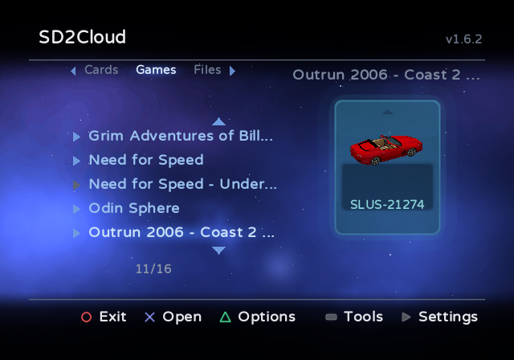
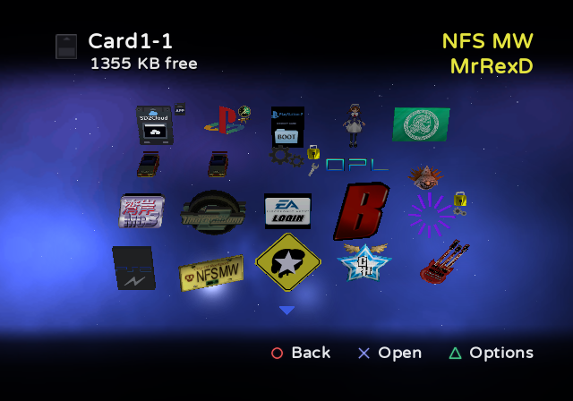
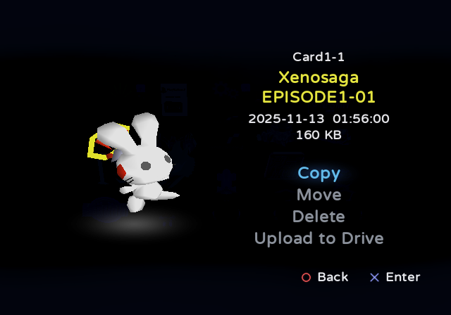
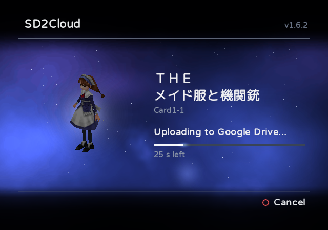
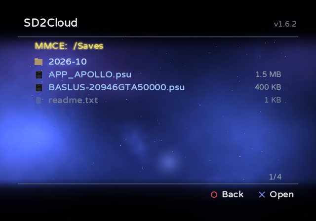
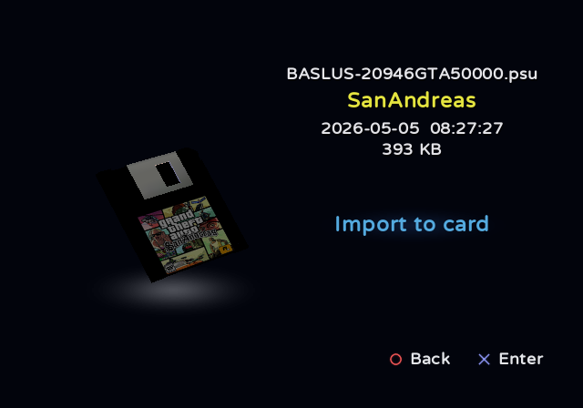

<h1>
  <picture>
    <source media="(prefers-color-scheme: dark)" srcset="docs/logo/dark.png">
    <source media="(prefers-color-scheme: light)" srcset="docs/logo/light.png">
    
  </picture>
</h1>

**Manage and back up your PS2 memory cards, right on the console.**

> [!WARNING]
> SD2Cloud changes your memory cards when it copies, moves, deletes, imports or restores saved data, and when it
> creates, resizes or deletes cards. Keep a backup before you do: sync your cards to Google Drive, or copy the
> `MemoryCards` folder of the microSD to a PC.

SD2Cloud runs on the PS2 itself. It works with the memory cards on the microSD of sd2psx-family devices running the
[sd2psXtd](https://github.com/sd2psXtd/firmware) firmware (sd2psx, PSXMemCard, PSXMemCard Gen2, PicoMemcard+/Zero;
the PS2 calls it the MMCE) and of the MemCard PRO2, and with regular Memory Cards, the OPL's virtual memory cards
(VMC) and memory card files on a USB drive, an MX4SIO or the internal HDD. No PC is required.

**English** · [Português](README.pt-BR.md) · [Español](README.es.md) · [Русский](README.ru.md) · [Українська](README.uk.md) · [日本語](README.ja.md)

  
  

  
  

  
  

## Features

**Cloud sync**
- Syncs your memory cards with your Google Drive, on demand or automatically every time you exit a game with IGR.
  Only the cards that changed are uploaded.
- Keeps a history of backups for each card (10 by default) and restores any of them, verified before and after
  writing. A changed card is synced before it is restored, so nothing is lost.
- Sends each card as the sd2psx's own `.mcd` or, if you choose so in the settings, as a `.ps2`, the format PCSX2
  uses: take it out of the backup's zip and it is ready for the emulator. Both can be restored.
- **Backup by save**: optionally sends each save that changed by itself too, with its versions; a save's page lists
  its **Versions on Drive** and puts any of them back.
- Keeps the backups organized by device, game and card, each card with its own Saves folder, and browses them from
  the **Files** tab: a save's page, a card's backup opened as a card, any file downloaded or deleted.
- Signs in once with a code or a QR code. SD2Cloud can only access the files it creates in your Drive.

**Memory card manager**
- Shows the saved data of each card the way the PS2 browser does, with animated 3D icons.
- Copies, moves and deletes saved data between cards (several at once, selected on one card or on more than one),
  and uploads a single item to Google Drive as a `.psu` file.
- **The Library**: keeps saves off the cards (a Memory Card that is full, a save you want out of a card without
  deleting it), each one in a file of its own, by game, with no size limit; optionally on Drive too.
- **Card tools**: creates cards (numbered, in a folder of your own, or as a card file on any device; 1 to 64 MB on
  an sd2psx, 8 to 128 MB on a MemCard PRO2, with a recommended size), resizes, renames, checks and deletes them,
  and **converts a card to Game ID** (each game's saves copied to its own card, on one screen with the time left).
  A **safety copy** of the card is kept before any change that could lose data, and put back from Tools.
- Organizes the cards in tabs: numbered cards and your own folders, game (Game ID) cards in folders named after
  each game, boot cards, the **OPL's VMCs** (with the games that use each one; also the VMC folders of the HDD, an
  MX4SIO or a USB drive) and the Library.
- Shows the saved data of every game card on one screen (**All saves**, in the Games tab), as if it were a single
  card.
- Marks the card the sd2psx is using and can make it take another one. To change the card in use, it asks,
  switches the sd2psx to another card and switches back.
- The **Files** tab browses the MMCE, a USB drive, the internal HDD (exFAT, FAT32 and APA, including disks set up
  by the PSBBN installer with both) and an MX4SIO: imports and exports `.psu` files and saves in folder format, opens
  memory card files (`.mcd`, `.mc2`, `.ps2`, OPL's `.bin`, or a `.zip`) and installs them as cards, and copies a whole
  card to a folder as a `.zip`.
- Manages the regular **Memory Cards** in the console's slots: their saves, the whole card uploaded to Drive and
  restored from it.
- On a microSD with the cards of both an sd2psx and a MemCard PRO2, **L2 and R2** switch between the two devices'
  cards, to copy saves between them.
- Keeps **templates**: sets of saved data you mark on your cards, put into any card in one go. One can be the
  **default** one, the one every game card should have: it goes into all of them at once, and the card of a new
  game is offered it when SD2Cloud opens. With the automatic sync, the card a game used gets its templates by
  itself when the game is left. They are in **Tools** (SELECT).

**Also**
- Works **without an sd2psx**: started from a USB drive, an MX4SIO or the internal HDD, SD2Cloud keeps its data
  there and manages the Memory Cards in both slots, the OPL's VMCs and card files.
- Asks for confirmation before anything that uploads, writes or deletes data.
- Settings on the console (START), in pages, saved to `sd2cloud.ini`, which can also be edited on a PC.
- Returns to OPL on the MMCE, a memory card, USB, MX4SIO or the internal HDD (exFAT or APA), loading only the
  drivers of that device.
- Starts other programs: any ELF picked in the folders of a device (X on it in **Files**, or "Run an ELF..." when
  leaving), and an application kept on a memory card the Save Application System's way ("Start application" on
  its page).
- Updates itself from this repository's releases, verified against GitHub's SHA-256. Two channels, chosen in the
  settings: **Stable**, the released versions, and **Beta**, a build made automatically from every change, before it
  is tested the way a version is (the [beta pre-release](../../releases/tag/beta)).
- Interface inspired by the PlayStation BB Navigator.
- English, Portuguese, Spanish, Russian, Ukrainian and Japanese. Translations are welcome: see
  [Translating](CONTRIBUTING.md#translating). The saves of Japanese games show their titles in Japanese.

## Requirements

- One of these:
  - an sd2psx-family device with the sd2psXtd firmware (MMCE support);
  - a MemCard PRO2: SD2Cloud reads and writes its `.mc2` cards in `/PS2`. Switching cards from the app ("Insert this
    card") is a preview there, and SD2Cloud never switches by itself: to change the card in use, switch to another
    one first;
  - neither: SD2Cloud on a USB drive, an MX4SIO or the internal HDD, with regular Memory Cards in the slots.
- A way to start SD2Cloud: the Apps tab of OPL, wLaunchELF or any other launcher that can run an ELF. An OPL with
  MMCE support is recommended, such as [RiptOPL](https://github.com/NathanNeurotic/Open-PS2-Loader). Without it, OPL
  does not list the apps on the MMCE and has no **IGR Bootcard Slot(s)** option: with Game ID cards, the sd2psx stays
  on the game's card when you exit with IGR, the PS2 goes back to the browser instead of opening SD2Cloud, and the
  automatic sync does not happen.
- For the automatic sync after a game: OPL, which starts SD2Cloud through its IGR.
- For the cloud features: a PS2 with a network adapter (built into Slim models), connected to your router with a
  cable, and a Google account.

## Installation

1. Download `SD2Cloud-vX.Y.zip` from the [latest release](../../releases/latest).
2. Extract it to the root of the MMCE. It adds `APPS/SD2Cloud` (the application) and
   `SD2Cloud/sd2cloud.ini` (the settings, explained in `sd2cloud.example.ini` next to it). The cover and the logo
   OPL shows for SD2Cloud in its Apps tab go to the `ART` folder. The same art with its line in
   Portuguese is in `Extras/ART pt-BR`, to copy over those two files.
3. Open SD2Cloud: from the Apps tab of OPL, or by running `APPS/SD2Cloud/SD2CLOUD.ELF` with any launcher
   (wLaunchELF, for example). The folder does not have to stay in `APPS`.
4. Connect your Google account when asked (or later, in Settings > Google Drive): visit google.com/device on your
   phone or computer, or scan the QR code, and enter the code shown on the TV.
5. SD2Cloud then offers to turn on automatic sync and to sync all your cards.

**Without an sd2psx**, extract the zip to a USB drive (FAT32 or exFAT), an MX4SIO or the internal HDD instead, and
open `APPS/SD2Cloud/SD2CLOUD.ELF` from there: SD2Cloud keeps its settings and data on that device.

With an sd2psx, SD2Cloud can also live on a USB drive, an MX4SIO card or the internal HDD (exFAT or APA): put the
`APPS/SD2Cloud` folder there and open SD2Cloud from there once. It records where it is, keeps on the MMCE
(`SD2Cloud/drivers`) the drivers the SAS package needs to start it from that device, and updates itself there. Its
settings and its data stay on the MMCE.

**On the memory card: the SAS package.** When automatic sync is turned on, SD2Cloud puts its SAS (Save Application
System) package on the memory card in use: the `APP_SD2CLOUD` folder, with what OPL runs on IGR and a shortcut that
opens SD2Cloud from the MMCE, with its own 3D icon for the PS2 browser (about 240 KB). The program itself stays
on the MMCE. The zip also has the package as `Extras/APP_SD2CLOUD.psu`, to import into another card by hand
(SD2Cloud's own **Files** tab does that); with no SD2Cloud on the MMCE, the shortcut only says so.

**Coming from a version before 2.0?** The backups on Drive are offered the new organization (by device, game and
card) once, at startup: the files are moved into it, with nothing uploaded again. "Not now" keeps the earlier one,
and Settings > Google Drive offers it again.

The [README.txt](package/README.txt) included in the release explains every screen in detail.

## Controls

| Screen | Buttons |
|---|---|
| Main screen | Up/Down: card · Left/Right or L1/R1: tab · L2/R2: the other device's cards (a microSD with both) · X: open the card · TRIANGLE: card options (sync now, restore a backup, copy to a device, insert into the sd2psx, rename, change size, convert to Game ID, check card, delete card) · SELECT: tools · START: settings · O: exit |
| Inside a card | X: open a save · TRIANGLE: options (sync this card; the saves by name or by date; convert to Game ID; in All saves, duplicates shown or hidden and export all to a card; on the Memory Card, upload it to Drive or restore a backup) · O: back |
| A save's page | Copy · Move · Delete · Upload to Drive · Versions on Drive |
| After Copy | The save is selected, and so can others be: X selects or deselects a save · O: leave the card for the list of cards, to select saves on other cards too · TRIANGLE: cancel · START: paste them all into the card that is open, or into the one under the cursor in the list. In the list's Games tab, the folder of their game comes first, highlighted, with "New card" in it. The Library tab keeps them off the cards. In the Files tab, X opens a device's folders: START pastes them there as `.psu` files, or into the memory card file under the cursor. START on the Memory Card pastes them into it |
| Files tab | X: open the device, a folder, a `.psu` file or a memory card file · SQUARE: install the selected `.psu` or save folder in a card, or the selected memory card file on the MMCE · Left/Right: a page up or down · O: back |
| Files tab > Google Drive | X: open a folder, a save's `.psu` (its page: import to card, download, delete from Drive) or a card's backup (its card) · SQUARE: download the file · TRIANGLE: delete it (to Drive's trash) · O: back |
| Tools (SELECT) | Templates (X: a new template or an existing one; TRIANGLE: set as default, add saves, apply template, linked games, rename, delete) · Safety copies (X: put one back, or delete it) |
| Settings (START) | Sync all cards · Google Drive (account, backups kept, format, backup by save, Library on Drive) · Automatic sync (on or off, SAS package, IGR path) · Cards (device, new card size, OPL VMC folders) · Language · Updates · About |
| During a sync | O: cancel · SQUARE: skip the card being uploaded · SELECT: the list of the sync's cards, with what became of each, and back. On it, SQUARE skips a card (again: undo) and X offers to skip it, mark it as resolved (the automatic sync leaves it alone until it changes again) or turn its sync off |

## Automatic sync after a game (IGR)

1. In SD2Cloud, open Settings (START) > Automatic sync and select **SAS package** (it is also offered right after
   you sign in). SD2Cloud shows how much space it takes (about 240 KB) and asks before writing the `APP_SD2CLOUD`
   folder to the memory card in use; with Autoboot, install it while the BootCard is in use.
2. In OPL Settings, set **IGR Path** to `mc0:/APP_SD2CLOUD/IGR.ELF` (`mc1:` with the sd2psx in slot 2: SD2Cloud
   shows the path to use when it installs the package). If a version up to 1.5 left its helper on the
   card (`mc0:/BOOT/SD2CLOUD-IGR.ELF`), that path keeps working: installing the package also brings that file up
   to date.
3. In OPL, also turn on **IGR Bootcard Slot(s)** (MMCE page), set to the sd2psx slot or BOTH: when you exit a game,
   OPL switches back to the BootCard, where the package is installed.

From then on, exiting a game with IGR starts SD2Cloud, which uploads the cards that changed and returns to OPL.
The same option reinstalls or uninstalls the package. SD2Cloud can be kept in any folder of the MMCE:
when it is not in `APPS/SD2Cloud`, it records where it is in `sd2cloud.ini`, and the package starts it from there
(a folder of `APPS` that was renamed is found too).

To pause the sync and keep everything installed, set **Automatic sync** to Off in Settings: IGR then goes
straight to the program opened after it, without starting SD2Cloud. The same happens while no Google account is
connected.

**Without installing anything (USB drive).** OPL's IGR can also start a program from a USB drive. If the
`APPS/SD2Cloud` folder is on one, formatted as FAT32, skip step 1 and set **IGR Path** to
`mass:/APPS/SD2Cloud/SD2CLOUD-IGR.ELF`: nothing is written to the memory card. For this, OPL loads the USB drivers
`USBD.IRX` and `USBHDFSD.IRX` from `mc?:/SYS-CONF`, where FMCB installs them. With the SAS package on the memory card
none of that is needed, wherever SD2Cloud is: the package starts it from the MMCE, a USB drive, an MX4SIO or the HDD.
If your OPL is not on the MMCE, set its path in the `[igr]` section of `sd2cloud.ini`, starting with
the device: `mc?:/` (memory card), `mass:/` (USB), `mx4sio:/`, `ata:/` (internal HDD, exFAT) or
`hdd0:PARTITION:pfs:/` (internal HDD, APA), for example `hdd0:__common:pfs:/APPS/OPL/OPNPS2LD.ELF`.

## Privacy

Your memory cards go from the PS2 straight to your own Google Drive; no other server is involved and nothing is
collected. SD2Cloud uses the `drive.file` scope, so it can only see the files it creates. Access can be revoked at
any time at [myaccount.google.com/permissions](https://myaccount.google.com/permissions). Besides Google, SD2Cloud
only contacts GitHub, and only when you select Check for updates in the settings.

## Building

SD2Cloud is written in C with the [ps2dev](https://github.com/ps2dev) toolchain (ps2sdk, ps2sdk-ports, gsKit).

1. `tools/build_ports.sh` builds wolfSSL and curl with 4096-bit RSA support into `ports4096/` (Google's HTTPS needs it).
2. `tools/build_mmceman.sh` builds mmceman, the sd2psx driver, into `third_party/mmceman/` (the one that comes with
   the SDK can hang the sd2psx during long transfers).
3. Create an OAuth client of type "TVs and Limited Input devices" in the Google Cloud Console, with the Drive API
   enabled, and generate `src/credentials.h`: `python tools/make_credentials.py client_secret.json src/credentials.h`.
4. `make` builds `dist/SD2CLOUD.ELF` and, in `igr/`, the two small programs of the SAS package (the IGR helper and
   the shortcut); `make DEBUG=1` builds a debug version for PCSX2.
5. `python tools/make_release.py` packages the release in `dist/`, with the texts in `package/`.

`make -C tests` runs the regression tests, with a PC's own compiler and no PS2 toolchain: see
[tests/README.md](tests/README.md). [docs/ARCHITECTURE.md](docs/ARCHITECTURE.md) is the map of the code.

## Reporting bugs and contributing

Found a problem? Open an [issue](../../issues/new/choose) and fill in the form: the SD2Cloud version, the console,
the sd2psx device and its firmware, how SD2Cloud was started and the steps that lead to the problem. Ideas and
suggestions are welcome there too. Issues can be written in English or in Portuguese.

Pull requests are welcome. [CONTRIBUTING.md](CONTRIBUTING.md) explains how to build, the conventions of the code
and what to check before sending one.

## Credits and license

SD2Cloud is developed by MrRexD and distributed under the [GNU General Public License v3](LICENSE).

The design is inspired by the PlayStation BB Navigator. SD2Cloud uses the
[Varela Round](https://github.com/alefalefalef/Varela-Round-Hebrew) font, with the Cyrillic letters of
[Nunito](https://github.com/googlefonts/nunito) and the Japanese characters of
[M PLUS Rounded 1c](https://github.com/coz-m/MPLUS_FONTS) (all three under the SIL Open Font License), and the
libraries listed in [THIRD-PARTY-NOTICES.txt](package/THIRD-PARTY-NOTICES.txt).

PlayStation is a registered trademark of Sony Interactive Entertainment. SD2Cloud is not affiliated with or
endorsed by Sony or Google.
