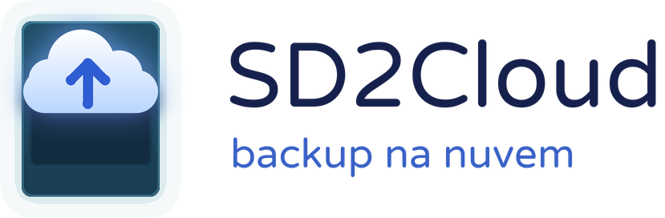
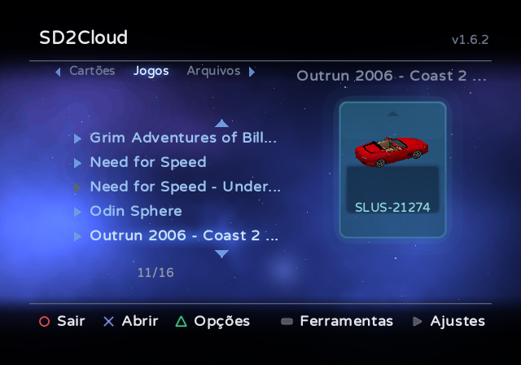
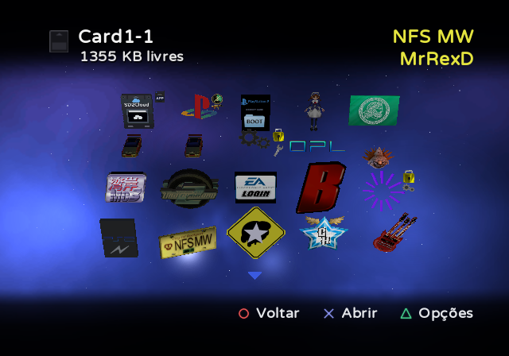
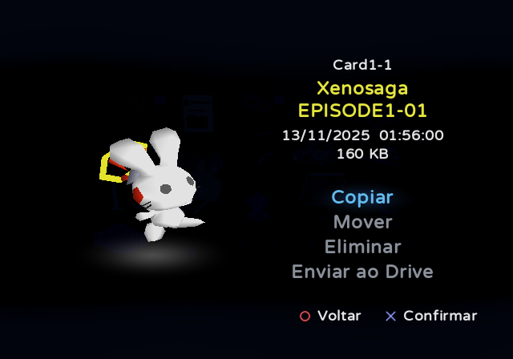
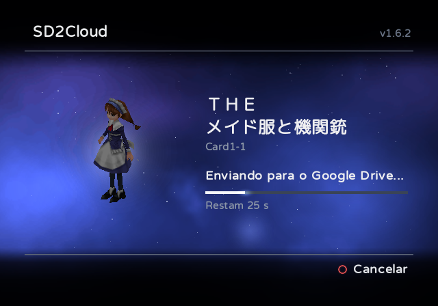
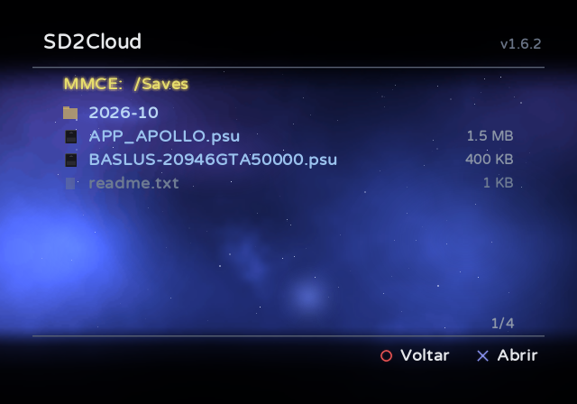
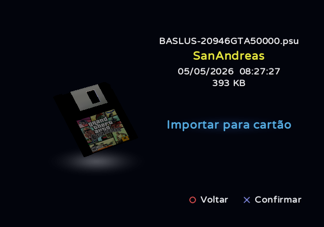

<h1>
  <picture>
    <source media="(prefers-color-scheme: dark)" srcset="docs/logo/pt-BR/dark.png">
    <source media="(prefers-color-scheme: light)" srcset="docs/logo/pt-BR/light.png">
    
  </picture>
</h1>

**Gerencie e proteja os cartões de memória do seu PS2, direto no console.**

> [!WARNING]
> O SD2Cloud altera os seus cartões de memória quando copia, move, exclui, importa ou restaura dados salvos, e
> quando cria, redimensiona ou exclui cartões. Faça um backup antes: sincronize os cartões com o Google Drive, ou
> copie a pasta `MemoryCards` do microSD para um PC.

O SD2Cloud roda no próprio PS2. Ele trabalha com os cartões de memória do microSD dos dispositivos da família
sd2psx com o firmware [sd2psXtd](https://github.com/sd2psXtd/firmware) (sd2psx, PSXMemCard, PSXMemCard Gen2,
PicoMemcard+/Zero; o PS2 o chama de MMCE) e do MemCard PRO2, e com Memory Cards comuns, os cartões virtuais do OPL
(VMC) e arquivos de cartão de memória em um pendrive USB, um MX4SIO ou no HD interno. Não é preciso um PC.

[English](README.md) · **Português** · [Español](README.es.md) · [Русский](README.ru.md) · [Українська](README.uk.md) · [日本語](README.ja.md)

  
  

  
  

  
  

## Recursos

**Sincronização com a nuvem**
- Sincroniza os cartões de memória com o seu Google Drive, quando você quiser ou automaticamente sempre que você sai
  de um jogo pelo IGR. Somente os cartões alterados são enviados.
- Mantém um histórico de backups de cada cartão (10 por padrão) e restaura qualquer um deles, com verificação antes e
  depois da gravação. Um cartão alterado é sincronizado antes de ser restaurado, para que nada se perca.
- Envia cada cartão como o `.mcd` do próprio sd2psx ou, se você escolher nos ajustes, como `.ps2`, o formato usado
  pelo PCSX2: é só tirar de dentro do zip do backup que ele está pronto para o emulador. Os dois podem ser restaurados.
- **Backup por save**: se você quiser, envia também cada save alterado separadamente, com as suas versões; a página
  do save lista as **Versões no Drive** e restaura qualquer uma.
- Guarda os backups organizados por aparelho, jogo e cartão, cada cartão com a sua pasta Saves, e navega por eles
  pela aba **Arquivos**: a página de um save, o backup de um cartão aberto como cartão, qualquer arquivo baixado ou
  excluído.
- Conecta a conta uma vez, com um código ou um QR code. O SD2Cloud só tem acesso aos arquivos que ele mesmo cria no
  seu Drive.

**Gerenciador de cartões de memória**
- Exibe os dados salvos de cada cartão como o navegador do PS2, com os ícones 3D animados.
- Copia, move e exclui dados salvos entre cartões (vários de uma vez, selecionados em um cartão ou em mais de um), e
  envia um item avulso ao Google Drive como arquivo `.psu`.
- **Biblioteca**: guarda saves fora dos cartões (um Memory Card cheio, um save que você quer tirar de um cartão sem
  excluir), cada um num arquivo próprio, separado por jogo, sem limite de espaço; se você quiser, também no Drive.
- **Ferramentas de cartão**: cria cartões (numerados, em uma pasta sua ou como arquivo de cartão em qualquer
  dispositivo; de 1 a 64 MB no sd2psx, de 8 a 128 MB no MemCard PRO2, com um tamanho recomendado), redimensiona,
  renomeia, verifica e exclui, e **converte um cartão para Game ID** (os saves de cada jogo copiados para o cartão do
  próprio jogo, numa tela só, com o tempo restante). Antes de qualquer alteração que possa perder dados, guarda uma
  **cópia de segurança** do cartão, que pode ser restaurada pelas Ferramentas.
- Organiza os cartões em abas: cartões numerados e pastas suas, cartões de jogos (Game ID) em pastas com o nome de
  cada jogo, cartões de boot, os **VMCs do OPL** (com os jogos que usam cada um; também as pastas de VMC do HD, de um
  MX4SIO ou de um pendrive) e a Biblioteca.
- Mostra os dados salvos de todos os cartões de jogos numa tela só (**Todos os saves**, na aba Jogos), como se
  fossem um único cartão.
- Marca o cartão que o sd2psx está usando e pode fazê-lo assumir outro. Para alterar o cartão em uso, ele pergunta,
  troca o sd2psx para outro cartão e volta.
- A aba **Arquivos** navega pelo MMCE, por um pendrive USB, pelo HD interno (exFAT, FAT32 e APA, inclusive os discos
  preparados pelo instalador do PSBBN, com os dois) e por um MX4SIO: importa e exporta arquivos `.psu` e saves em
  formato de pasta, abre arquivos de cartão de memória (`.mcd`, `.mc2`, `.ps2`, o `.bin` do OPL ou um `.zip`) e os
  instala como cartões, e copia um cartão inteiro para uma pasta, como `.zip`.
- Gerencia os **Memory Cards** comuns dos slots do console: os saves deles, o cartão inteiro enviado ao Drive e
  restaurado de lá.
- Num microSD com os cartões de um sd2psx e de um MemCard PRO2, **L2 e R2** alternam entre os cartões de um e do
  outro, para copiar saves entre os dois.
- Guarda **templates**: conjuntos de dados salvos que você marca nos seus cartões, colocados em qualquer cartão de
  uma vez. Um deles pode ser o **principal**, o que todo cartão de jogo deve ter: ele vai para todos de uma vez, e o
  cartão de um jogo novo o recebe quando o SD2Cloud abre. Com a sincronização automática, o cartão que um jogo usou
  recebe os templates dele sozinho quando o jogo é encerrado. Ficam em **Ferramentas** (SELECT).

**Além disso**
- Funciona **sem sd2psx**: aberto de um pendrive, de um MX4SIO ou do HD interno, o SD2Cloud guarda os dados ali e
  gerencia os Memory Cards dos dois slots, os VMCs do OPL e os arquivos de cartão.
- Pede confirmação antes de qualquer coisa que envie, grave ou apague dados.
- Ajustes no próprio console (START), em páginas, salvos no `sd2cloud.ini`, que também pode ser editado no PC.
- Volta para o OPL no MMCE, em um cartão de memória, no USB, no MX4SIO ou no HD interno (exFAT ou APA), carregando
  só os drivers desse dispositivo.
- Abre outros programas: qualquer ELF escolhido nas pastas de um dispositivo (X sobre ele em **Arquivos**, ou
  "Executar um ELF..." ao sair), e um aplicativo guardado em um cartão de memória no formato do Save Application
  System ("Iniciar aplicativo" na página dele).
- Atualiza-se pelas releases deste repositório, conferindo o SHA-256 do GitHub. Dois canais, escolhidos nos ajustes:
  **Estável**, as versões lançadas, e **Beta**, uma compilação feita automaticamente a cada alteração, antes dos
  testes que uma versão recebe (a [pré-release beta](../../releases/tag/beta)).
- Interface inspirada no PlayStation BB Navigator.
- Em português, inglês, espanhol, russo, ucraniano e japonês. Traduções são bem-vindas: veja
  [Translating](CONTRIBUTING.md#translating). Os saves de jogos japoneses mostram o título em japonês.

## Requisitos

- Um destes:
  - um dispositivo da família sd2psx com o firmware sd2psXtd (suporte a MMCE);
  - um MemCard PRO2: o SD2Cloud lê e grava os cartões `.mc2` dele em `/PS2`. A troca de cartão pelo app ("Inserir
    este cartão") é um preview nele, e o SD2Cloud nunca troca sozinho: para alterar o cartão em uso, selecione outro
    antes;
  - nenhum dos dois: o SD2Cloud em um pendrive, um MX4SIO ou no HD interno, com Memory Cards comuns nos slots.
- Uma forma de abrir o SD2Cloud: a aba Apps do OPL, o wLaunchELF ou qualquer outro programa que abra um ELF.
  Recomenda-se um OPL com suporte a MMCE, como o [RiptOPL](https://github.com/NathanNeurotic/Open-PS2-Loader). Sem
  esse suporte, o OPL não lista os apps do MMCE e não tem a opção **Slot(s) de Bootcard IGR**: com cartões de Game ID,
  o sd2psx continua no cartão do jogo ao sair pelo IGR, o PS2 volta para o navegador em vez de abrir o SD2Cloud, e a
  sincronização automática não acontece.
- Para a sincronização automática após o jogo: o OPL, que abre o SD2Cloud pelo IGR.
- Para os recursos de nuvem: PS2 com adaptador de rede (integrado nos modelos Slim) conectado ao roteador por
  cabo, e uma conta do Google.

## Instalação

1. Baixe o `SD2Cloud-vX.Y.zip` da [release mais recente](../../releases/latest).
2. Extraia na raiz do MMCE. Serão criadas as pastas `APPS/SD2Cloud` (o aplicativo) e `SD2Cloud`,
   com o `sd2cloud.ini` (as configurações, explicadas no `sd2cloud.example.ini` ao lado dele). A capa e a logo
   que o OPL exibe para o SD2Cloud na aba Apps vão para a pasta `ART`. A mesma arte com a frase em
   português está em `Extras/ART pt-BR`, para copiar por cima desses dois arquivos.
3. Abra o SD2Cloud: pela aba Apps do OPL, ou executando `APPS/SD2Cloud/SD2CLOUD.ELF` em qualquer programa que abra
   um ELF (o wLaunchELF, por exemplo). A pasta não precisa ficar em `APPS`.
4. Conecte a sua conta do Google quando ele perguntar (ou depois, em Ajustes > Google Drive): acesse
   google.com/device no celular ou no computador, ou use o QR code, e digite o código exibido na TV.
5. Em seguida, o SD2Cloud oferece a sincronização automática e a sincronização de todos os cartões.

**Sem sd2psx**, extraia o zip em um pendrive (FAT32 ou exFAT), em um MX4SIO ou no HD interno, e abra
`APPS/SD2Cloud/SD2CLOUD.ELF` de lá: o SD2Cloud guarda as configurações e os dados nesse dispositivo.

Com um sd2psx, o SD2Cloud também pode ficar em um pendrive USB, em um cartão do MX4SIO ou no HD interno (exFAT ou
APA): coloque a pasta `APPS/SD2Cloud` lá e abra o SD2Cloud por lá uma vez. Ele registra onde está, guarda no MMCE
(`SD2Cloud/drivers`) os drivers de que o pacote SAS precisa para iniciá-lo nesse dispositivo e se atualiza ali
mesmo. As configurações e os dados continuam no MMCE.

**No cartão de memória: o pacote SAS.** Ao ativar a sincronização automática, o SD2Cloud grava o seu pacote SAS
(Save Application System) no cartão de memória em uso: a pasta `APP_SD2CLOUD`, com o que o OPL executa no IGR e um
atalho que abre o SD2Cloud do MMCE, com ícone 3D próprio para o navegador do PS2 (cerca de 240 KB). O programa em
si fica no MMCE. O zip traz também o pacote como `Extras/APP_SD2CLOUD.psu`, para importar à mão em outro cartão
(a aba **Arquivos** do próprio SD2Cloud faz isso); sem o SD2Cloud no MMCE, o atalho apenas avisa.

**Vindo de uma versão anterior à 2.0?** Os backups no Drive recebem uma vez, ao abrir, a oferta da nova organização
(por aparelho, jogo e cartão): os arquivos são movidos para ela, sem enviar nada de novo. "Agora não" mantém a
anterior, e Ajustes > Google Drive oferece de novo.

O [LEIA-ME.txt](package/LEIA-ME.txt) incluído na release explica cada tela em detalhes.

## Controles

| Tela | Botões |
|---|---|
| Tela principal | Cima/Baixo: cartão · Esquerda/Direita ou L1/R1: aba · L2/R2: os cartões do outro aparelho (num microSD com os dois) · X: abrir o cartão · TRIÂNGULO: opções do cartão (sincronizar agora, restaurar backup, copiar para dispositivo, inserir no sd2psx, renomear, alterar tamanho, converter para Game ID, verificar cartão, excluir cartão) · SELECT: ferramentas · START: ajustes · O: sair |
| Dentro de um cartão | X: abrir um item · TRIÂNGULO: opções (sincronizar este cartão; os itens por nome ou por data; converter para Game ID; em Todos os saves, repetidos ocultos ou exibidos e exportar todos para um cartão; no Memory Card, enviá-lo ao Drive ou restaurar um backup) · O: voltar |
| Página de um item | Copiar · Mover · Excluir · Enviar ao Drive · Versões no Drive |
| Depois de Copiar | O item fica selecionado, e outros também podem ficar: X seleciona ou desmarca um item · O: sair do cartão para a lista de cartões, para selecionar itens de outros cartões também · TRIÂNGULO: cancelar · START: colar todos no cartão que está aberto, ou no que está sob o cursor na lista. Na aba Jogos da lista, a pasta do jogo deles vem primeiro, em destaque, com "Novo cartão" dentro. A aba Biblioteca os guarda fora dos cartões. Na aba Arquivos, X abre as pastas de um dispositivo: START cola os itens ali como arquivos `.psu`, ou dentro do arquivo de cartão de memória sob o cursor. START no Memory Card cola os itens nele |
| Aba Arquivos | X: abrir o dispositivo, uma pasta, um arquivo `.psu` ou um arquivo de cartão de memória · QUADRADO: instalar o `.psu` ou a pasta de save selecionados em um cartão, ou o arquivo de cartão selecionado no MMCE · Esquerda/Direita: uma página acima ou abaixo · O: voltar |
| Aba Arquivos > Google Drive | X: abrir uma pasta, o `.psu` de um save (a página dele: importar para cartão, baixar, excluir do Drive) ou o backup de um cartão (o cartão) · QUADRADO: baixar o arquivo · TRIÂNGULO: excluí-lo (vai para a lixeira do Drive) · O: voltar |
| Ferramentas (SELECT) | Templates (X: um template novo ou um existente; TRIÂNGULO: definir como principal, adicionar saves, aplicar template, jogos vinculados, renomear, excluir) · Cópias de segurança (X: restaurar uma, ou excluí-la) |
| Ajustes (START) | Sincronizar todos os cartões · Google Drive (conta, backups mantidos, formato, backup por save, Biblioteca no Drive) · Sincronização automática (ativada ou desativada, pacote SAS, saída do IGR) · Cartões (dispositivo, tamanho dos cartões novos, pastas de VMC do OPL) · Idioma · Atualizações · Sobre |
| Durante uma sincronização | O: cancelar · QUADRADO: pular o cartão que está sendo enviado · SELECT: a lista dos cartões da sincronização, com a situação de cada um, e de volta. Nela, QUADRADO pula um cartão (de novo: desfaz) e X oferece pular, marcar como resolvido (a sincronização automática o deixa de lado até ele mudar de novo) ou desativar a sincronização dele |

## Sincronização automática após o jogo (IGR)

1. No SD2Cloud, abra Ajustes (START) > Sincronização automática e selecione **Pacote SAS** (ele também é oferecido
   logo depois de você conectar a conta). O SD2Cloud informa o espaço necessário (cerca de 240 KB) e pede
   confirmação antes de gravar a pasta `APP_SD2CLOUD` no cartão de memória em uso; com o Autoboot, faça a instalação
   com o BootCard em uso.
2. Nas configurações do OPL, em **Definir saída do IGR**, informe `mc0:/APP_SD2CLOUD/IGR.ELF` (`mc1:` com o sd2psx
   no slot 2: o SD2Cloud mostra o caminho certo ao instalar o pacote). Se uma versão até a
   1.5 deixou o assistente dela no cartão (`mc0:/BOOT/SD2CLOUD-IGR.ELF`), esse caminho continua valendo: instalar
   o pacote também atualiza esse arquivo.
3. No OPL, ative também **Slot(s) de Bootcard IGR** (página MMCE), no slot do sd2psx ou em BOTH: ao sair do jogo,
   o OPL volta para o BootCard, onde o pacote está instalado.

A partir daí, ao sair de um jogo pelo IGR, o SD2Cloud envia os cartões alterados e retorna ao OPL. A mesma opção
reinstala ou desinstala o pacote. O SD2Cloud pode ficar em qualquer pasta do MMCE: quando não
está em `APPS/SD2Cloud`, ele registra onde está no `sd2cloud.ini`, e o pacote o inicia a partir dali (uma pasta
de `APPS` que foi renomeada também é encontrada).

Para pausar a sincronização sem desinstalar nada, deixe **Sincronização automática** como Desativada nos Ajustes: o
IGR passa a ir direto para o programa aberto depois dele, sem iniciar o SD2Cloud. O mesmo acontece enquanto não há
conta do Google conectada.

**Sem instalar nada (pendrive USB).** O IGR do OPL também abre programas de um pendrive USB. Se a pasta
`APPS/SD2Cloud` estiver em um, formatado em FAT32, pule o passo 1 e informe `mass:/APPS/SD2Cloud/SD2CLOUD-IGR.ELF`
em **Definir saída do IGR**: nada é gravado no cartão de memória. Para isso, o OPL carrega os drivers USB
`USBD.IRX` e `USBHDFSD.IRX` de `mc?:/SYS-CONF`, onde o FMCB os instala. Com o pacote SAS no cartão de memória nada
disso é necessário, esteja o SD2Cloud onde estiver: o pacote o inicia do MMCE, de um pendrive USB, de um MX4SIO
ou do HD.

Se o seu OPL não estiver no MMCE, informe o caminho dele na seção `[igr]` do `sd2cloud.ini`, começando pelo
dispositivo: `mc?:/` (cartão de memória), `mass:/` (USB), `mx4sio:/`, `ata:/` (HD interno exFAT) ou
`hdd0:PARTIÇÃO:pfs:/` (HD interno APA), por exemplo `hdd0:__common:pfs:/APPS/OPL/OPNPS2LD.ELF`.

## Privacidade

Os seus cartões de memória vão do PS2 direto para o seu Google Drive; nenhum outro servidor é usado e nenhuma
informação é coletada. O SD2Cloud usa o escopo `drive.file`, então só enxerga os arquivos que ele mesmo cria. O
acesso pode ser revogado a qualquer momento em
[myaccount.google.com/permissions](https://myaccount.google.com/permissions). Além do Google, o SD2Cloud só se
comunica com o GitHub, e somente quando você seleciona Verificar atualizações nos ajustes.

## Compilação

O SD2Cloud é escrito em C com o toolchain do [ps2dev](https://github.com/ps2dev) (ps2sdk, ps2sdk-ports, gsKit).

1. `tools/build_ports.sh` compila o wolfSSL e o curl com suporte a RSA de 4096 bits em `ports4096/` (o HTTPS do
   Google exige isso).
2. `tools/build_mmceman.sh` compila o mmceman, o driver do sd2psx, em `third_party/mmceman/` (o que vem com o SDK
   pode travar o sd2psx em transferências longas).
3. Crie um cliente OAuth do tipo "TVs e dispositivos de entrada limitada" no Google Cloud Console, com a Drive API
   ativada, e gere o `src/credentials.h`: `python tools/make_credentials.py client_secret.json src/credentials.h`.
4. `make` gera o `dist/SD2CLOUD.ELF` e, em `igr/`, os dois programas pequenos do pacote SAS (o assistente de IGR e
   o atalho); `make DEBUG=1` gera uma versão de debug para o PCSX2.
5. `python tools/make_release.py` monta a release em `dist/`, com os textos de `package/`.

`make -C tests` roda os testes de regressão, com o compilador do próprio PC e sem o toolchain do PS2: veja
[tests/README.md](tests/README.md). O mapa do código está em [docs/ARCHITECTURE.md](docs/ARCHITECTURE.md) (em
inglês).

## Relatar bugs e colaborar

Encontrou um problema? Abra uma [issue](../../issues/new/choose) e preencha o formulário: a versão do SD2Cloud, o
console, o dispositivo sd2psx e o firmware dele, como o SD2Cloud foi aberto e os passos que levam ao problema.
Ideias e sugestões também são bem-vindas por lá. As issues podem ser escritas em português ou em inglês.

Pull requests são bem-vindos. O [CONTRIBUTING.md](CONTRIBUTING.md) explica como compilar, as convenções do código e
o que conferir antes de enviar um.

## Créditos e licença

O SD2Cloud é desenvolvido por MrRexD e distribuído sob a [GNU General Public License v3](LICENSE).

O visual é inspirado no PlayStation BB Navigator. O SD2Cloud usa a fonte
[Varela Round](https://github.com/alefalefalef/Varela-Round-Hebrew), com as letras cirílicas da
[Nunito](https://github.com/googlefonts/nunito) e os caracteres japoneses da
[M PLUS Rounded 1c](https://github.com/coz-m/MPLUS_FONTS) (as três sob a SIL Open Font License), e as bibliotecas
listadas no [THIRD-PARTY-NOTICES.txt](package/THIRD-PARTY-NOTICES.txt).

PlayStation é marca registrada da Sony Interactive Entertainment. O SD2Cloud não é afiliado nem endossado pela
Sony ou pelo Google.
