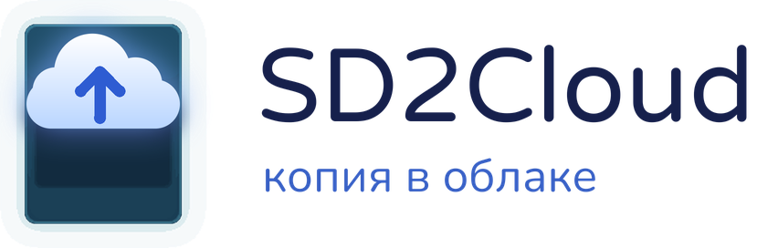
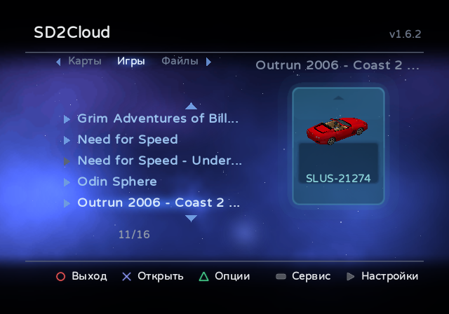
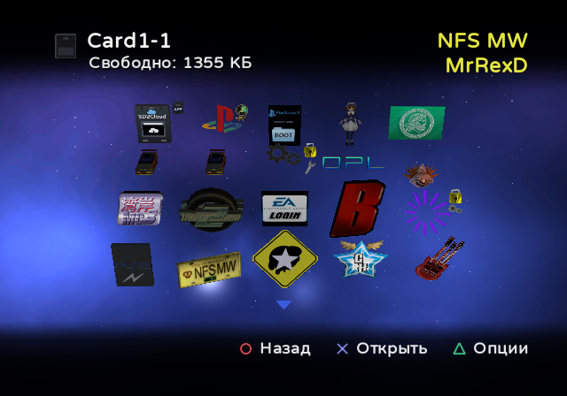
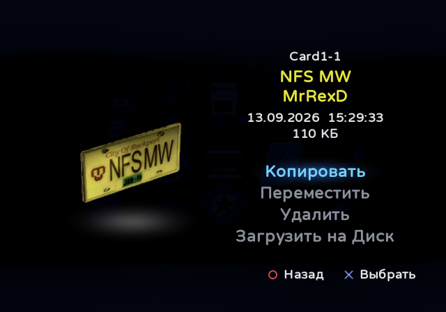
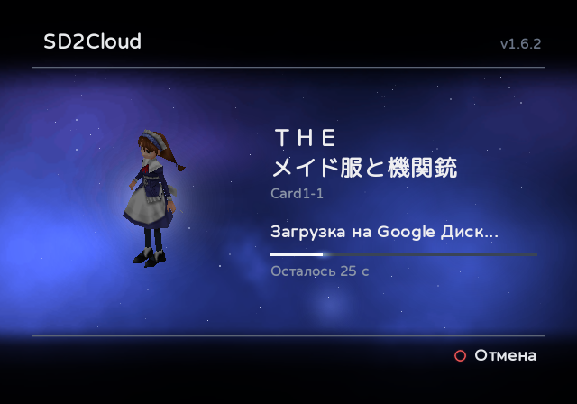
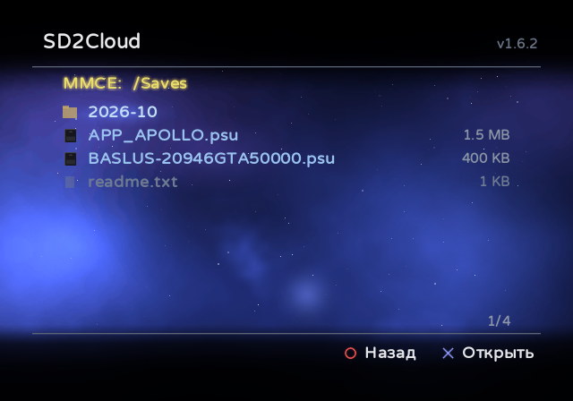
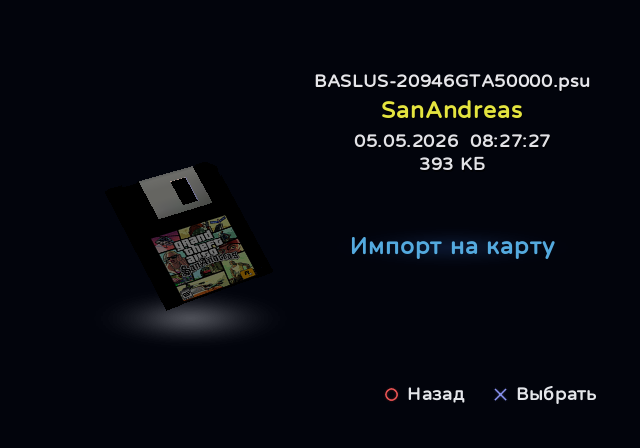

<h1>
  <picture>
    <source media="(prefers-color-scheme: dark)" srcset="docs/logo/ru/dark.png">
    <source media="(prefers-color-scheme: light)" srcset="docs/logo/ru/light.png">
    
  </picture>
</h1>

**Управление картами памяти sd2psx и их резервное копирование прямо на PS2.**

> [!WARNING]
> SD2Cloud находится на ранней стадии и ещё мало где проверен. Прежде чем копировать, перемещать, удалять,
> импортировать или восстанавливать сохранения с его помощью, сделайте копию карт памяти: скопируйте папку
> `MemoryCards` с microSD на ПК.

SD2Cloud работает на самой PS2 и работает с картами памяти, которые хранятся на MMCE (так PS2 называет microSD
sd2psx) устройств семейства sd2psx с прошивкой [sd2psXtd](https://github.com/sd2psXtd/firmware) (sd2psx,
PSXMemCard, PSXMemCard Gen2, PicoMemcard+/Zero). ПК не нужен. MemCard PRO2 тоже распознаётся, в экспериментальном
режиме: на ней SD2Cloud ещё не проверялся.

[English](README.md) · [Português](README.pt-BR.md) · [Español](README.es.md) · **Русский** · [Українська](README.uk.md)

  
  

  
  

  
  

## Возможности

**Синхронизация с облаком**
- Синхронизирует карты памяти с вашим Google Диском — по запросу или автоматически при каждом выходе из игры через
  IGR. Загружаются только изменившиеся карты.
- Хранит историю резервных копий каждой карты (по умолчанию 10) и восстанавливает любую из них с проверкой до и
  после записи. Изменившаяся карта синхронизируется перед восстановлением, поэтому ничего не теряется.
- Отправляет каждую карту в собственном формате sd2psx `.mcd` или, если выбрать в настройках, в формате `.ps2`,
  который использует PCSX2: достаньте его из zip-архива копии, и он готов для эмулятора. Восстановить можно оба.
- Вход выполняется один раз — по коду или QR-коду. SD2Cloud имеет доступ только к тем файлам на вашем Диске, которые
  создаёт сам.

**Менеджер карт памяти**
- Показывает сохранения каждой карты так же, как браузер PS2, с анимированными 3D-иконками.
- Копирует, перемещает и удаляет сохранения между картами на MMCE (показывается свободное место на карте назначения)
  и загружает отдельное сохранение на Google Диск в виде файла `.psu`. Можно скопировать сразу несколько сохранений,
  выбранных на одной карте или на нескольких. Сохранение можно также отправить на новую карту его игры, созданную на
  месте («Новая карта» на вкладке «Игры»): пустую карту на 8 МБ, такую же, какие создаёт само устройство.
- Показывает сохранения всех игровых карт на одном экране (**Все сохранения** на вкладке «Игры»), как будто это одна
  карта.
- Раскладывает карты по вкладкам: нумерованные карты, игровые карты (Game ID) в папках с названием каждой игры и
  загрузочные карты (Boot).
- Отмечает карту, которую использует sd2psx, и может переключить его на другую (в опциях карты). Чтобы сменить
  используемую карту, он спрашивает, переключает sd2psx на другую карту и возвращает обратно.
- Копирует карту целиком — как `.zip` с `.mcd` или `.ps2` внутри — в папку MMCE или USB-накопителя (в опциях карты).
- Открывает файлы карт памяти на вкладке **Файлы** (`.mcd`, `.mc2` от MemCard PRO2, `.ps2` от PCSX2, виртуальные
  карты OPL (`.bin`) или тот самый `.zip`), копирует из них сохранения и устанавливает их на MMCE: как новую карту
  (нумерованную, игровую или ещё один канал BootCard) или вместо существующей.
- Импортирует и экспортирует файлы `.psu`: вкладка **Файлы** открывает папки MMCE и USB-накопителя (FAT32 или
  exFAT), устанавливает `.psu` на любую карту и сохраняет любое сохранение карты как `.psu`. Записанное читается
  обратно и сверяется.
- Управляет обычной **картой памяти** в другом слоте консоли с вкладки **Файлы**: её сохранения показываются,
  копируются, перемещаются и удаляются так же, как у карт sd2psx, а на неё можно записывать сохранения с карт
  устройства или из файлов `.psu`.
- Хранит **шаблоны**: наборы сохранений, которые вы отмечаете на своих картах; они лежат на MMCE и записываются на
  любую карту за один раз. Устройство создаёт карту новой игры пустой; шаблон даёт ей то, что должно быть на каждой
  вашей карте, например сетевые настройки, которые просит онлайн-игра. Уже имеющиеся на карте сохранения никогда не
  затрагиваются. Один шаблон может быть **основным** — тем, что должен быть на каждой игровой карте: он записывается на
  все сразу, а когда SD2Cloud при запуске находит игровую карту без него (карту новой игры), он сообщает об этом и
  предлагает его записать. Шаблон может относиться и только к некоторым играм. При автосинхронизации карта, которую
  использовала игра, получает свои шаблоны сама при выходе из игры. Шаблоны находятся в разделе **Сервис** (SELECT).

**Кроме того**
- Просит подтверждения перед любым действием, которое загружает, записывает или удаляет данные.
- Настройки на консоли (START) сохраняются в `sd2cloud.ini`, который можно править и на ПК.
- Возвращается в OPL на MMCE, карте памяти, USB, MX4SIO или внутреннем жёстком диске (exFAT или APA), загружая
  только драйверы этого устройства.
- Запускает другие программы: любой ELF, выбранный в папках MMCE или USB-накопителя (X на нём во вкладке **Файлы**
  или «Запустить ELF...» при выходе), и приложение, хранящееся на карте памяти по правилам Save Application System
  («Запустить приложение» на его странице; для этого sd2psx переключается на ту карту).
- Обновляется из релизов этого репозитория с проверкой по SHA-256 из GitHub. Два канала на выбор в настройках:
  **Стабильный** — выпущенные версии, и **Beta** — сборка, которая создаётся автоматически при каждом изменении, до
  проверки, которую проходит версия ([пре-релиз beta](../../releases/tag/beta)).
- Интерфейс в стиле PlayStation BB Navigator.
- Английский, португальский, испанский, русский, украинский и японский языки. Переводы приветствуются: см.
  [Translating](CONTRIBUTING.md#translating). Сохранения японских игр показывают названия на японском.

## Требования

- Устройство семейства sd2psx с прошивкой sd2psXtd (поддержка MMCE). На MemCard PRO2 (экспериментально) SD2Cloud
  читает и записывает её карты `.mc2` в `/PS2`. Переключение карт из приложения («Вставить карту») там работает в
  режиме предварительного просмотра, и SD2Cloud никогда не переключает карту сам: чтобы сменить используемую карту,
  сначала переключитесь на другую.
- Способ запустить SD2Cloud: вкладка Apps в OPL, wLaunchELF или любой другой загрузчик, умеющий запускать ELF.
  Рекомендуется OPL с поддержкой MMCE, например [RiptOPL](https://github.com/NathanNeurotic/Open-PS2-Loader). Без
  неё OPL не показывает приложения на MMCE sd2psx и не имеет опции **IGR Bootcard Slot(s)**: с картами Game ID
  sd2psx остаётся на карте игры при выходе через IGR, PS2 возвращается в браузер вместо запуска SD2Cloud, и
  автосинхронизация не выполняется.
- Для автосинхронизации после игры: OPL, который запускает SD2Cloud через свой IGR.
- Для облачных функций: PS2 с сетевым адаптером (встроен в модели Slim), подключённая к роутеру кабелем, и аккаунт
  Google.

## Установка

1. Скачайте `SD2Cloud-vX.Y.zip` из [последнего релиза](../../releases/latest).
2. Распакуйте его в корень MMCE. Добавятся `APPS/SD2Cloud` (приложение) и `SD2Cloud/sd2cloud.ini` (настройки,
   описанные в лежащем рядом `sd2cloud.example.ini`). Обложка и логотип, которые OPL показывает для SD2Cloud на
   вкладке Apps, попадают в папку `ART`. Тот же арт с подписью на португальском лежит в `Extras/ART pt-BR`, чтобы
   скопировать его поверх этих двух файлов.
3. Откройте SD2Cloud: с вкладки Apps в OPL или запустив `APPS/SD2Cloud/SD2CLOUD.ELF` любым загрузчиком (например,
   wLaunchELF). Папка не обязана оставаться в `APPS`.
4. Подключите аккаунт Google, когда будет предложено (или позже, в настройках): откройте google.com/device на
   телефоне или компьютере либо отсканируйте QR-код и введите код, показанный на экране телевизора.
5. Затем SD2Cloud предложит включить автосинхронизацию и синхронизировать все ваши карты.

SD2Cloud может также находиться на USB-накопителе, карте MX4SIO или внутреннем жёстком диске (exFAT или APA):
положите туда папку `APPS/SD2Cloud` и один раз откройте SD2Cloud оттуда. Он запомнит, где находится, сохранит на
MMCE (`SD2Cloud/drivers`) драйверы, которые нужны пакету SAS, чтобы запускать его с этого устройства, и будет
обновляться там же. Его настройки и данные всегда хранятся на MMCE.

**На карте памяти: пакет SAS.** При включении автосинхронизации SD2Cloud записывает свой пакет SAS (Save
Application System) на используемую карту памяти: папку `APP_SD2CLOUD` с тем, что OPL запускает по IGR, и ярлыком,
который открывает SD2Cloud с MMCE, со своей 3D-иконкой для браузера PS2 (около 240 КБ). Сама программа остаётся на
MMCE. В zip-архиве пакет также есть в виде `Extras/APP_SD2CLOUD.psu`, чтобы вручную импортировать его на другую
карту (это умеет вкладка **Файлы** самого SD2Cloud); если SD2Cloud на MMCE нет, ярлык только сообщает об этом.

Входящий в релиз [README.txt](package/README.txt) подробно описывает каждый экран (на английском).

## Управление

| Экран | Кнопки |
|---|---|
| Главный экран | Вверх/Вниз: карта · Влево/Вправо или L1/R1: вкладка · X: открыть карту · ТРЕУГОЛЬНИК: опции карты (синхронизировать сейчас, восстановить из копии, копировать на устройство, вставить в sd2psx) · SELECT: сервис · START: настройки · O: выход |
| Внутри карты | X: открыть сохранение · ТРЕУГОЛЬНИК: опции (синхронизировать эту карту; сохранения по имени или по дате; во «Всех сохранениях» — повторы скрыты или показаны) · O: назад |
| Страница сохранения | Копировать · Переместить · Удалить · Загрузить на Диск |
| После «Копировать» | Сохранение выбрано, и можно выбрать другие: X выбирает или снимает выбор · O: выйти из карты, чтобы выбрать сохранения и на других картах · START: вставить все на карту под курсором или на открытую карту. На вкладке «Файлы» X открывает папки устройства: START вставляет их туда как файлы `.psu`, а X на файле карты памяти открывает его, чтобы выбрать его сохранения или вставить их внутрь кнопкой START; START на карте памяти вставляет их в неё (на карте, откуда они взяты, START спрашивает, куда: на другую карту, на новую карту их игры или в папку) |
| Вкладка «Файлы» | X: открыть устройство, папку, файл `.psu` или файл карты памяти · КВАДРАТ: установить выбранный `.psu` на карту или выбранный файл карты на MMCE · Влево/Вправо: страница вверх или вниз · O: назад. Чтобы экспортировать сохранения, используйте **Копировать** на странице одного из них: эта вкладка — одно из мест, куда их можно вставить, и START записывает каждый `.psu` в открытую папку |
| Сервис (SELECT) > Шаблоны | X: новый шаблон (вводится его имя; затем на картах отмечаются его сохранения: X отмечает, START завершает) или существующий · В шаблоне: X: сохранение, чтобы убрать его · ТРЕУГОЛЬНИК (на шаблоне в списке или в открытом шаблоне): сделать основным, добавить сохранения, применить шаблон (ко всем игровым картам, к выбранным картам или только обновив сохранения, которые уже есть на игровых картах), связанные игры, переименовать, удалить |
| Во время синхронизации | O: отмена · КВАДРАТ: пропустить загружаемую карту · SELECT: список карт синхронизации с состоянием каждой, и обратно. В нём КВАДРАТ пропускает карту (повторно — отменяет), а X предлагает пропустить её, отметить как решённую (автосинхронизация не трогает её, пока она снова не изменится) или отключить её синхронизацию |

## Автосинхронизация после игры (IGR)

1. В SD2Cloud откройте настройки (START) и выберите **Пакет SAS** (его также предлагают сразу после входа).
   SD2Cloud покажет, сколько места он занимает (около 240 КБ), и спросит, прежде чем записать папку `APP_SD2CLOUD` на
   используемую карту памяти; с Autoboot устанавливайте его, пока используется BootCard.
2. В настройках OPL укажите в **IGR Path** `mc0:/APP_SD2CLOUD/IGR.ELF` (`mc1:`, если sd2psx во втором слоте: при
   установке пакета SD2Cloud показывает нужный путь). Если версия до 1.5 оставила свой помощник на карте
   (`mc0:/BOOT/SD2CLOUD-IGR.ELF`), этот путь продолжает работать: установка пакета обновляет и этот файл.
3. В OPL также включите **IGR Bootcard Slot(s)** (страница MMCE), выбрав слот sd2psx или BOTH: при выходе из игры OPL
   возвращается на BootCard, где установлен пакет.

С этого момента выход из игры через IGR запускает SD2Cloud, который загружает изменившиеся карты и возвращается в
OPL. Тот же пункт переустанавливает или удаляет пакет. SD2Cloud может лежать в любой папке MMCE: если он не в
`APPS/SD2Cloud`, он записывает своё местоположение в `sd2cloud.ini`, и пакет запускает его оттуда (переименованная
папка в `APPS` тоже находится).

Чтобы приостановить синхронизацию, ничего не удаляя, выберите для **Автосинхронизации** значение «Выкл.» в настройках
(START): тогда IGR сразу переходит к программе, открываемой после него, не запуская SD2Cloud. То же самое происходит,
пока не подключён аккаунт Google.

**Без установки (USB-накопитель).** IGR в OPL может также запускать программу с USB-накопителя. Если папка
`APPS/SD2Cloud` находится на нём (в FAT32), пропустите шаг 1 и укажите в **IGR Path**
`mass:/APPS/SD2Cloud/SD2CLOUD-IGR.ELF`: на карту памяти ничего не записывается. Для этого OPL загружает USB-драйверы
`USBD.IRX` и `USBHDFSD.IRX` из `mc?:/SYS-CONF`, куда их устанавливает FMCB. С пакетом SAS на карте памяти всё это не
нужно, где бы ни находился SD2Cloud: пакет запускает его с MMCE, USB-накопителя, MX4SIO или жёсткого диска. Если ваш
OPL не на MMCE, укажите путь к нему в разделе `[igr]` файла `sd2cloud.ini`, начиная с устройства: `mc?:/` (карта
памяти), `mass:/` (USB), `mx4sio:/`, `ata:/` (внутренний жёсткий диск, exFAT) или `hdd0:РАЗДЕЛ:pfs:/` (внутренний
жёсткий диск, APA), например `hdd0:__common:pfs:/APPS/OPL/OPNPS2LD.ELF`.

## Конфиденциальность

Ваши карты памяти отправляются с PS2 прямо на ваш собственный Google Диск; другие серверы не участвуют, и ничего
не собирается. SD2Cloud использует область доступа `drive.file`, поэтому видит только созданные им файлы. Доступ можно
отозвать в любой момент на [myaccount.google.com/permissions](https://myaccount.google.com/permissions). Помимо
Google, SD2Cloud обращается только к GitHub, и только когда вы выбираете «Проверять обновления» в настройках.

## Сборка

SD2Cloud написан на C с помощью инструментов [ps2dev](https://github.com/ps2dev) (ps2sdk, ps2sdk-ports, gsKit).

1. `tools/build_ports.sh` собирает wolfSSL и curl с поддержкой 4096-битного RSA в `ports4096/` (это нужно для HTTPS
   Google).
2. `tools/build_mmceman.sh` собирает mmceman, драйвер sd2psx, в `third_party/mmceman/` (тот, что идёт с SDK, может
   подвешивать sd2psx при длинных передачах).
3. Создайте в Google Cloud Console OAuth-клиент типа «TVs and Limited Input devices» с включённым Drive API и
   сгенерируйте `src/credentials.h`: `python tools/make_credentials.py client_secret.json src/credentials.h`.
4. `make` собирает `dist/SD2CLOUD.ELF`, а в `igr/` — две небольшие программы пакета SAS (помощник IGR и ярлык);
   `make DEBUG=1` собирает отладочную версию для PCSX2.
5. `python tools/make_release.py` упаковывает релиз в `dist/` вместе с текстами из `package/`.

`make -C tests` запускает регрессионные тесты компилятором самого ПК, без инструментов PS2: см.
[tests/README.md](tests/README.md). [docs/ARCHITECTURE.md](docs/ARCHITECTURE.md) — карта кода.

## Сообщения об ошибках и участие

Нашли проблему? Откройте [issue](../../issues/new/choose) и заполните форму: версия SD2Cloud, консоль, устройство
sd2psx и его прошивка, как был запущен SD2Cloud и шаги, которые приводят к проблеме. Идеи и предложения там тоже
приветствуются. Issue можно писать на английском или португальском.

Pull request'ы приветствуются. [CONTRIBUTING.md](CONTRIBUTING.md) объясняет, как собрать проект, соглашения в коде и
что проверить перед отправкой.

## Авторы и лицензия

SD2Cloud разрабатывает MrRexD, распространяется под лицензией [GNU General Public License v3](LICENSE).

Дизайн вдохновлён PlayStation BB Navigator. SD2Cloud использует шрифт
[Varela Round](https://github.com/alefalefalef/Varela-Round-Hebrew) с кириллицей из
[Nunito](https://github.com/googlefonts/nunito) и японскими символами из
[M PLUS Rounded 1c](https://github.com/coz-m/MPLUS_FONTS) (все три — под SIL Open Font License), а также библиотеки,
перечисленные в [THIRD-PARTY-NOTICES.txt](package/THIRD-PARTY-NOTICES.txt).

PlayStation — зарегистрированный товарный знак Sony Interactive Entertainment. SD2Cloud не связан с Sony или Google и
не одобрен ими.
