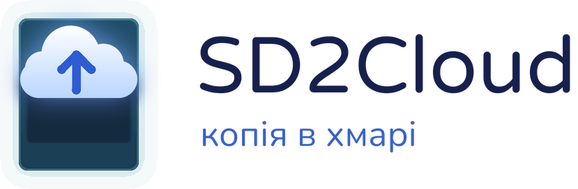
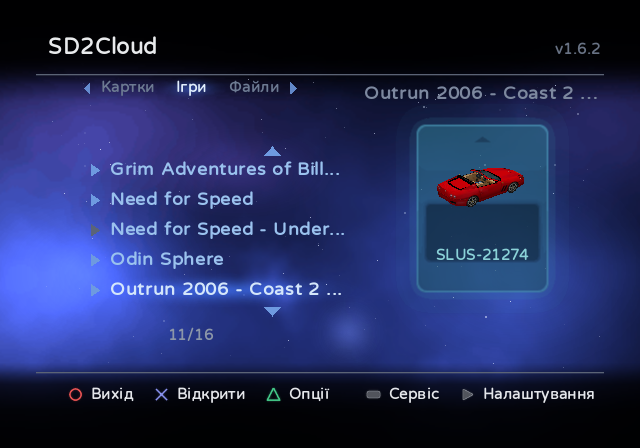
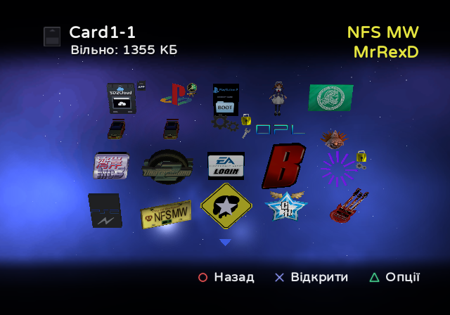
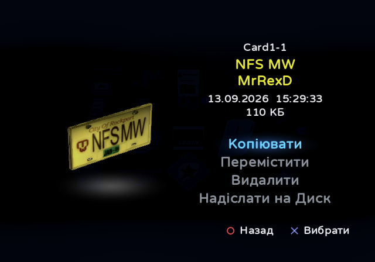
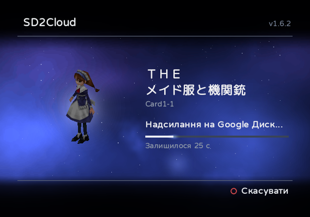
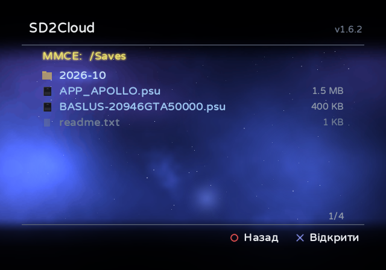
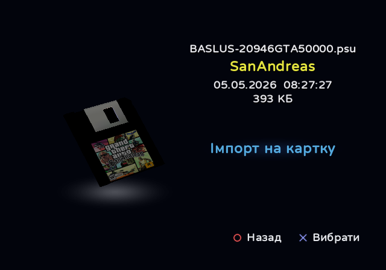

<h1>
  <picture>
    <source media="(prefers-color-scheme: dark)" srcset="docs/logo/uk/dark.png">
    <source media="(prefers-color-scheme: light)" srcset="docs/logo/uk/light.png">
    
  </picture>
</h1>

**Керування картками пам’яті PS2 і їх резервне копіювання просто на консолі.**

> [!WARNING]
> SD2Cloud змінює ваші картки пам’яті, коли копіює, переміщує, видаляє, імпортує або відновлює збереження, а також
> коли створює, змінює розмір або видаляє картки. Спершу зробіть копію: синхронізуйте картки з Google Диском або
> скопіюйте папку `MemoryCards` з microSD на ПК.

SD2Cloud працює на самій PS2. Він працює з картками пам’яті на microSD пристроїв сімейства sd2psx із прошивкою
[sd2psXtd](https://github.com/sd2psXtd/firmware) (sd2psx, PSXMemCard, PSXMemCard Gen2, PicoMemcard+/Zero; PS2 називає
її MMCE) і MemCard PRO2, а також зі звичайними картками пам’яті, віртуальними картками OPL (VMC) і файлами карток
пам’яті на USB-накопичувачі, MX4SIO або внутрішньому жорсткому диску. ПК не потрібен.

[English](README.md) · [Português](README.pt-BR.md) · [Español](README.es.md) · [Русский](README.ru.md) · **Українська** · [日本語](README.ja.md)

  
  

  
  

  
  

## Можливості

**Синхронізація з хмарою**
- Синхронізує картки пам’яті з вашим Google Диском — на запит або автоматично щоразу, коли ви виходите з гри через
  IGR. Надсилаються лише картки, що змінилися.
- Зберігає історію резервних копій кожної картки (типово 10) і відновлює будь-яку з них із перевіркою до і після
  запису. Картка, що змінилася, синхронізується перед відновленням, тож нічого не втрачається.
- Надсилає кожну картку у власному форматі sd2psx `.mcd` або, якщо вибрати в налаштуваннях, у форматі `.ps2`, який
  використовує PCSX2: дістаньте його з zip-архіву копії, і він готовий для емулятора. Відновити можна обидва.
- **Копії за збереженнями**: за бажанням надсилає також кожне змінене збереження окремо, з його версіями; на сторінці
  збереження є **Версії в Drive**, і будь-яку з них можна повернути.
- Розкладає копії за пристроями, іграми та картками, у кожної картки своя папка збережень, і показує їх на вкладці
  **Файли**: сторінка збереження, копія картки, відкрита як картка або встановлена, завантаження чи видалення
  будь-якого файлу.
- Вхід виконується один раз — за кодом або QR-кодом. SD2Cloud має доступ лише до тих файлів на вашому Диску, які
  створює сам.

**Менеджер карток пам’яті**
- Показує збереження кожної картки так само, як браузер PS2, з анімованими 3D-іконками.
- Копіює, переміщує й видаляє збереження між картками (по кілька одразу, вибраних на одній картці або на кількох) і
  надсилає окреме збереження на Google Диск як файл `.psu`.
- **Бібліотека**: зберігає збереження поза картками (картка пам’яті заповнена або збереження треба прибрати з картки,
  не видаляючи), кожне в окремому файлі, за іграми, без обмеження місця; за бажанням — і на Диску.
- **Інструменти для карток**: створює картки (нумеровані, у своїй папці або як файл картки на будь-якому пристрої; від
  1 до 64 МБ на sd2psx, від 8 до 128 МБ на MemCard PRO2, з рекомендованим розміром), змінює їхній розмір,
  перейменовує, перевіряє й видаляє, а також **перетворює картку на Game ID** (збереження кожної гри копіюються на
  картку цієї гри, на одному екрані, із залишком часу). Перед будь-якою зміною, за якої можна втратити дані,
  зберігається **страхова копія** картки, яку можна повернути з розділу «Сервіс».
- Розкладає картки по вкладках: нумеровані картки та ваші папки, ігрові картки (Game ID) у папках із назвою кожної
  гри, завантажувальні картки, **VMC OPL** (з іграми, що використовують кожну; також папки VMC жорсткого диска, MX4SIO
  або USB-накопичувача) і Бібліотека.
- Показує збереження всіх ігрових карток на одному екрані (**Усі збереження** на вкладці «Ігри»), ніби це одна
  картка.
- Позначає картку, яку використовує sd2psx, і може перемкнути його на іншу. Щоб змінити картку, що використовується,
  він питає, перемикає sd2psx на іншу картку й повертає назад.
- Вкладка **Файли** відкриває MMCE, USB-накопичувач, внутрішній жорсткий диск (exFAT, FAT32 і APA, зокрема диски,
  підготовлені інсталятором PSBBN з обома) і MX4SIO: імпортує та експортує файли `.psu` і збереження у вигляді папки,
  відкриває файли карток пам’яті (`.mcd`, `.mc2`, `.ps2`, `.bin` від OPL або `.zip`) і встановлює їх як картки або
  як файл картки на будь-який пристрій, у вибраному форматі, а також копіює картку цілком до папки як `.zip`.
- Керує звичайними **картками пам’яті** у слотах консолі: їхні збереження, надсилання всієї картки на Диск і
  відновлення звідти.
- На microSD з картками і sd2psx, і MemCard PRO2 кнопки **L2 і R2** перемикають між картками двох пристроїв, щоб
  копіювати збереження між ними.
- Зберігає **шаблони**: набори збережень, які ви позначаєте на своїх картках і записуєте на будь-яку картку за один
  раз. Один може бути **основним** — тим, що має бути на кожній ігровій картці: він записується на всі одразу, а картка
  нової гри отримує його під час запуску SD2Cloud. З автосинхронізацією картка, яку використала гра, отримує свої
  шаблони сама під час виходу з гри. Шаблони — у розділі **Сервіс** (SELECT).

**Крім того**
- Працює **без sd2psx**: запущений з USB-накопичувача, MX4SIO або внутрішнього жорсткого диска, SD2Cloud зберігає дані
  там і керує картками пам’яті в обох слотах (з копією кожного збереження), VMC OPL і файлами карток.
- sd2psx можна вийняти й вставити назад, коли SD2Cloud відкритий: екрани це враховують.
- Просить підтвердження перед будь-якою дією, що надсилає, записує або видаляє дані.
- Налаштування на консолі (START), за сторінками, зберігаються в `sd2cloud.ini`, який можна редагувати й на ПК.
- Повертається до OPL на MMCE, картці пам’яті, USB, MX4SIO або внутрішньому жорсткому диску (exFAT або APA),
  завантажуючи лише драйвери цього пристрою.
- Запускає інші програми: будь-який ELF, вибраний у папках пристрою (X на ньому у вкладці **Файли** або «Запустити
  ELF...» під час виходу), і застосунок, що зберігається на картці пам’яті за правилами Save Application System
  («Запустити застосунок» на його сторінці).
- Оновлюється з релізів цього репозиторію з перевіркою за SHA-256 із GitHub. Два канали на вибір у налаштуваннях:
  **Стабільний** — випущені версії, і **Beta** — збірка, що створюється автоматично після кожної зміни, до перевірки,
  яку проходить версія ([пре-реліз beta](../../releases/tag/beta)).
- Інтерфейс у стилі PlayStation BB Navigator.
- Англійська, португальська, іспанська, російська, українська та японська мови. Переклади вітаються: див.
  [Translating](CONTRIBUTING.md#translating). Збереження японських ігор показують назви японською.

## Вимоги

- Одне з:
  - пристрій сімейства sd2psx із прошивкою sd2psXtd (підтримка MMCE);
  - MemCard PRO2: SD2Cloud читає й записує її картки `.mc2` у `/PS2`. Перемикання карток із застосунку («Вставити
    картку») там працює в режимі попереднього перегляду, і SD2Cloud ніколи не перемикає картку сам: щоб змінити
    картку, що використовується, спочатку перемкніться на іншу;
  - ні того, ні іншого: SD2Cloud на USB-накопичувачі, MX4SIO або внутрішньому жорсткому диску, зі звичайними картками
    пам’яті у слотах.
- Спосіб запустити SD2Cloud: вкладка Apps в OPL, wLaunchELF або будь-який інший завантажувач, що вміє запускати ELF.
  Рекомендується OPL із підтримкою MMCE, наприклад [RiptOPL](https://github.com/NathanNeurotic/Open-PS2-Loader). Без
  неї OPL не показує застосунки на MMCE і не має опції **IGR Bootcard Slot(s)**: з картками Game ID sd2psx лишається
  на картці гри після виходу через IGR, PS2 повертається до браузера замість запуску SD2Cloud, і автосинхронізація не
  виконується.
- Для автосинхронізації після гри: OPL, який запускає SD2Cloud через свій IGR.
- Для хмарних функцій: PS2 з мережевим адаптером (вбудований у моделі Slim), під’єднана до роутера кабелем, і акаунт
  Google.

## Встановлення

1. Завантажте `SD2Cloud-vX.Y.zip` з [останнього релізу](../../releases/latest).
2. Розпакуйте його в корінь MMCE. Додадуться `APPS/SD2Cloud` (застосунок) і `SD2Cloud/sd2cloud.ini` (налаштування,
   описані в розташованому поруч `sd2cloud.example.ini`). Обкладинка й логотип, які OPL показує для SD2Cloud на вкладці
   Apps, потрапляють до папки `ART`. Той самий арт із підписом португальською лежить у `Extras/ART pt-BR`, щоб
   скопіювати його поверх цих двох файлів.
3. Відкрийте SD2Cloud: із вкладки Apps в OPL або запустивши `APPS/SD2Cloud/SD2CLOUD.ELF` будь-яким завантажувачем
   (наприклад, wLaunchELF). Папка не мусить лишатися в `APPS`.
4. Під’єднайте акаунт Google, коли буде запропоновано (або пізніше, в Налаштування > Google Drive): відкрийте
   google.com/device на телефоні чи комп’ютері або відскануйте QR-код і введіть код, показаний на екрані телевізора.
5. Потім SD2Cloud запропонує ввімкнути автосинхронізацію та синхронізувати всі ваші картки.

**Без sd2psx** розпакуйте zip-архів на USB-накопичувач (FAT32 або exFAT), MX4SIO або внутрішній жорсткий диск і
відкрийте `APPS/SD2Cloud/SD2CLOUD.ELF` звідти: SD2Cloud зберігає налаштування й дані на цьому пристрої.
Синхронізує він картки пам’яті у слотах, за збереженнями (копії за збереженнями ввімкнено за замовчуванням), і
перша синхронізація одразу їх пропонує. Папки sd2psx на цьому пристрої там — просто файли: відкривайте їх на
вкладці **Файли**.

З sd2psx SD2Cloud може також бути на USB-накопичувачі, картці MX4SIO або внутрішньому жорсткому диску (exFAT або APA):
покладіть туди папку `APPS/SD2Cloud` і один раз відкрийте SD2Cloud звідти. Він запам’ятає, де він є, збереже на MMCE
(`SD2Cloud/drivers`) драйвери, потрібні пакету SAS, щоб запускати його з цього пристрою, і оновлюватиметься там само.
Його налаштування й дані лишаються на MMCE.

**На картці пам’яті: пакет SAS.** Під час увімкнення автосинхронізації SD2Cloud записує свій пакет SAS (Save
Application System) на картку пам’яті, що використовується: папку `APP_SD2CLOUD` з тим, що OPL запускає за IGR, і
ярликом, який відкриває SD2Cloud там, де він є, зі своєю 3D-іконкою для браузера PS2 (близько 240 КБ; без sd2psx
ще й драйвери пристрою, на якому лежить SD2Cloud, приблизно на 90 КБ більше). Сама програма лишається на своєму
місці. У zip-архіві пакет також є у вигляді `Extras/APP_SD2CLOUD.psu`, щоб вручну імпортувати його на іншу картку
(це вміє вкладка **Файли** самого SD2Cloud): відкрийте SD2Cloud один раз звідти, де він є, і ярлик його
знаходитиме.

**Переходите з версії до 2.0?** Копіям на Диску один раз, під час запуску, пропонується нова структура (за
пристроями, іграми та картками): файли переносяться в неї без повторного завантаження. «Не зараз» залишає попередню, а
Налаштування > Google Drive пропонує її знову.

[README.txt](package/README.txt), що входить до релізу, докладно описує кожен екран (англійською).

## Керування

| Екран | Кнопки |
|---|---|
| Головний екран | Вгору/Вниз: картка · Вліво/Вправо або L1/R1: вкладка · L2/R2: картки іншого пристрою (на microSD з обома) · X: відкрити картку · ТРИКУТНИК: опції картки (синхронізувати зараз, відновити з копії, копіювати на пристрій, вставити в sd2psx, перейменувати, змінити розмір, перетворити на Game ID, перевірити картку, видалити картку) · SELECT: сервіс · START: налаштування · O: вихід |
| Усередині картки | X: відкрити збереження · ТРИКУТНИК: опції (синхронізувати цю картку; збереження за назвою або за датою; перетворити на Game ID; в «Усіх збереженнях» — повтори приховані або показані та експорт усіх на картку; на картці пам’яті — надіслати її на Диск або відновити з копії) · O: назад |
| Сторінка збереження | Копіювати · Перемістити · Видалити · Надіслати на Диск · Версії в Drive |
| Після «Копіювати» | Збереження вибране, і можна вибрати інші: X вибирає або знімає вибір · O: вийти з картки до списку карток, щоб вибрати збереження й на інших картках · ТРИКУТНИК: скасувати · START: вставити всі у відкриту картку або в картку під курсором у списку. На вкладці «Ігри» списку папка їхньої гри йде першою й виділена, а всередині неї є «Нова картка». Вкладка «Бібліотека» зберігає їх поза картками. На вкладці «Файли» X відкриває папки пристрою: START вставляє їх туди як файли `.psu` або у файл картки пам’яті під курсором. START на картці пам’яті вставляє їх у неї |
| Вкладка «Файли» | X: відкрити пристрій, папку, файл `.psu` або файл картки пам’яті · КВАДРАТ: встановити вибраний `.psu` або папку збереження на картку або вибраний файл картки як картку MMCE чи як файл на пристрій (його вкладка «Файли») · Вліво/Вправо: сторінка вгору чи вниз · O: назад |
| Вкладка «Файли» > Google Drive | X: відкрити папку, `.psu` збереження (його сторінка: імпорт на картку, завантажити, видалити з Drive) або копію картки (саму картку) · КВАДРАТ: встановити копію картки (як із самої картки), завантажити будь-який інший файл · ТРИКУТНИК: видалити його (до кошика Диска) · O: назад |
| Сервіс (SELECT) | Шаблони (X: новий шаблон або наявний; ТРИКУТНИК: зробити основним, додати збереження, застосувати шаблон, пов’язані ігри, перейменувати, видалити) · Страхові копії (X: повернути копію або видалити її) |
| Налаштування (START) | Синхронізувати всі картки · Google Drive (акаунт, кількість копій, формат, копії за збереженнями, Бібліотека на Диску) · Автосинхронізація (увімк. або вимк., пакет SAS, вихід з IGR) · Картки (пристрій, розмір нових карток, папки VMC OPL) · Оновлення · Мова · Про програму |
| Під час синхронізації | O: скасувати · КВАДРАТ: пропустити картку, що надсилається · SELECT: список карток синхронізації зі станом кожної, і назад. У ньому КВАДРАТ пропускає картку (повторно — скасовує), а X пропонує пропустити її, позначити як вирішену (автосинхронізація не чіпає її, доки вона знову не зміниться) або вимкнути її синхронізацію |

## Автосинхронізація після гри (IGR)

1. У SD2Cloud відкрийте Налаштування (START) > Автосинхронізація і виберіть **Пакет SAS** (його також пропонують
   одразу після входу). SD2Cloud покаже, скільки місця він займає (близько 240 КБ), і спитає, перш ніж записати папку
   `APP_SD2CLOUD` на картку пам’яті, що використовується; з Autoboot встановлюйте його, поки використовується BootCard.
2. У налаштуваннях OPL укажіть в **IGR Path** `mc0:/APP_SD2CLOUD/IGR.ELF` (`mc1:`, якщо sd2psx у другому слоті:
   під час встановлення пакета SD2Cloud показує потрібний шлях). Якщо версія до 1.5 залишила свій помічник на картці
   (`mc0:/BOOT/SD2CLOUD-IGR.ELF`), цей шлях і далі працює: встановлення пакета оновлює й цей файл.
3. В OPL також увімкніть **IGR Bootcard Slot(s)** (сторінка MMCE), вибравши слот sd2psx або BOTH: після виходу з гри
   OPL повертається на BootCard, де встановлено пакет.

Відтепер вихід із гри через IGR запускає SD2Cloud, який надсилає картки, що змінилися, і повертається до OPL. Той
самий пункт перевстановлює або видаляє пакет. SD2Cloud може лежати в будь-якій папці, на MMCE або на іншому
пристрої: щоразу, коли його відкривають, він записує своє розташування (в `sd2cloud.ini` на MMCE; без sd2psx — у сам
пакет, разом із драйверами цього пристрою), і пакет запускає його звідти (перейменована папка в `APPS` теж
знаходиться).

Щоб призупинити синхронізацію, нічого не видаляючи, виберіть для **Автосинхронізації** значення «Вимк.» у
налаштуваннях: тоді IGR одразу переходить до програми, що відкривається після нього, не запускаючи SD2Cloud. Те саме
відбувається, поки не під’єднано акаунт Google.

**Без встановлення (USB-накопичувач).** IGR в OPL може також запускати програму з USB-накопичувача. Якщо папка
`APPS/SD2Cloud` лежить на ньому (у FAT32), пропустіть крок 1 і вкажіть в **IGR Path**
`mass:/APPS/SD2Cloud/SD2CLOUD-IGR.ELF`: на картку пам’яті нічого не записується. Для цього OPL завантажує
USB-драйвери `USBD.IRX` і `USBHDFSD.IRX` з `mc?:/SYS-CONF`, куди їх встановлює FMCB. З пакетом SAS на картці пам’яті
все це не потрібно, хоч би де був SD2Cloud: пакет запускає його з MMCE, USB-накопичувача, MX4SIO або жорсткого диска.
Якщо ваш OPL не на MMCE, укажіть шлях до нього в розділі `[igr]` файлу `sd2cloud.ini`, починаючи з пристрою: `mc?:/`
(картка пам’яті), `mass:/` (USB), `mx4sio:/`, `ata:/` (внутрішній жорсткий диск, exFAT) або `hdd0:РОЗДІЛ:pfs:/`
(внутрішній жорсткий диск, APA), наприклад `hdd0:__common:pfs:/APPS/OPL/OPNPS2LD.ELF`.

## Конфіденційність

Ваші картки пам’яті надходять із PS2 просто на ваш власний Google Диск; інші сервери не беруть участі, і нічого не
збирається. SD2Cloud використовує область доступу `drive.file`, тож бачить лише створені ним файли. Доступ можна
відкликати будь-коли на [myaccount.google.com/permissions](https://myaccount.google.com/permissions). Крім Google,
SD2Cloud звертається лише до GitHub, і лише коли ви вибираєте «Перевіряти оновлення» в налаштуваннях.

## Збирання

SD2Cloud написаний мовою C за допомогою інструментів [ps2dev](https://github.com/ps2dev) (ps2sdk, ps2sdk-ports, gsKit).

1. `tools/build_ports.sh` збирає wolfSSL і curl із підтримкою 4096-бітного RSA в `ports4096/` (це потрібно для HTTPS
   Google).
2. `tools/build_mmceman.sh` збирає mmceman, драйвер sd2psx, у `third_party/mmceman/` (той, що постачається з SDK,
   може підвішувати sd2psx під час довгих передавань).
3. Створіть у Google Cloud Console OAuth-клієнт типу «TVs and Limited Input devices» з увімкненим Drive API і
   згенеруйте `src/credentials.h`: `python tools/make_credentials.py client_secret.json src/credentials.h`.
4. `make` збирає `dist/SD2CLOUD.ELF`, а в `igr/` — дві невеликі програми пакета SAS (помічник IGR і ярлик);
   `make DEBUG=1` збирає налагоджувальну версію для PCSX2.
5. `python tools/make_release.py` пакує реліз у `dist/` разом із текстами з `package/`.

`make -C tests` запускає регресійні тести компілятором самого ПК, без інструментів PS2: див.
[tests/README.md](tests/README.md). [docs/ARCHITECTURE.md](docs/ARCHITECTURE.md) — мапа коду.

## Повідомлення про помилки та участь

Знайшли проблему? Відкрийте [issue](../../issues/new/choose) і заповніть форму: версія SD2Cloud, консоль, пристрій
sd2psx і його прошивка, як було запущено SD2Cloud і кроки, що призводять до проблеми. Ідеї та пропозиції там теж
вітаються. Issue можна писати англійською або португальською.

Pull request’и вітаються. [CONTRIBUTING.md](CONTRIBUTING.md) пояснює, як зібрати проєкт, домовленості в коді та що
перевірити перед надсиланням.

## Автори та ліцензія

SD2Cloud розробляє MrRexD, поширюється за ліцензією [GNU General Public License v3](LICENSE).

Дизайн натхненний PlayStation BB Navigator. SD2Cloud використовує шрифт
[Varela Round](https://github.com/alefalefalef/Varela-Round-Hebrew) з кирилицею з
[Nunito](https://github.com/googlefonts/nunito) і японськими символами з
[M PLUS Rounded 1c](https://github.com/coz-m/MPLUS_FONTS) (усі три — за SIL Open Font License), а також бібліотеки,
перелічені в [THIRD-PARTY-NOTICES.txt](package/THIRD-PARTY-NOTICES.txt).

PlayStation — зареєстрована торговельна марка Sony Interactive Entertainment. SD2Cloud не пов’язаний із Sony чи Google
і не схвалений ними.
